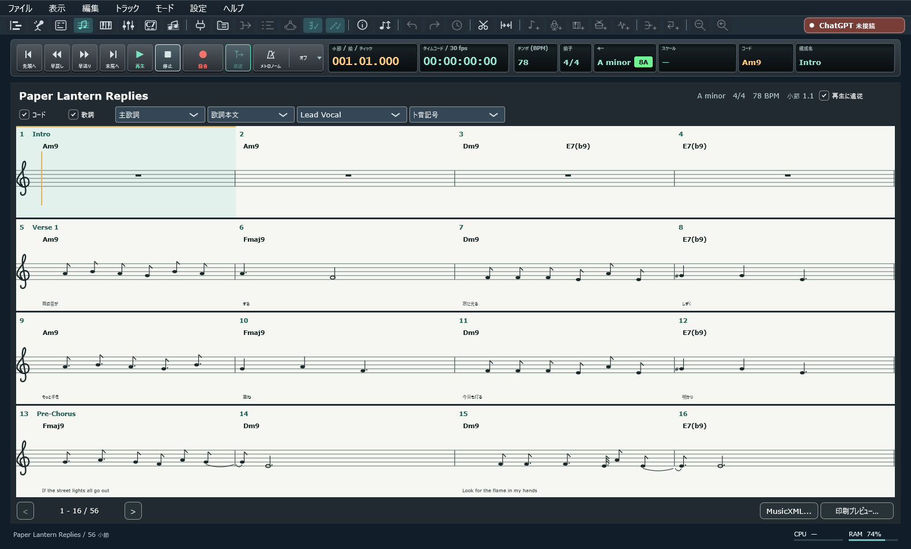
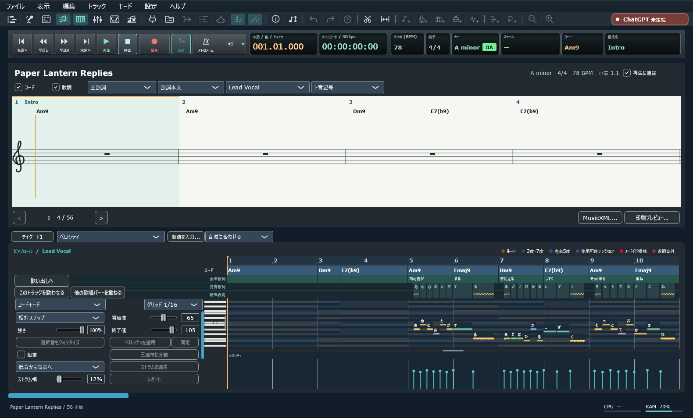

# OSTF Studio 操作マニュアル

[English](en.md) · [プラグイン図鑑](../plugins/README.md) · [リポジトリのトップ](../../README.ja.md)

このマニュアルの画像は公開アルファ2のWindows画面です。インストーラーには単体版と41本のVST3が含まれます。Macではプロセッサーに合うDMGを選び、中のパッケージを起動してください。

## 普段のDAWでデモ曲を鳴らす

Ableton LiveやCubaseを普段使っている方は、そのDAWのインストゥルメントトラックに **OSTF Studio** をVST3として挿してください。Studioでコードや歌詞を編集しながら、普段のDAWで他のトラックを録音・ミックスできます。

1. **インストールする。** 対応する公開アルファ2のWindows版のセットアップを開きます。初期状態は全選択です。デモで試すなら「他のDAWで使う Studio VST3（デモ曲の音源・エフェクト付き）」を選べます。手動で選ぶ場合の項目名は **OSTF Studio (VST3)** です。
2. **DAWに挿す。** VST3を再スキャンし、インストゥルメント一覧で **OSTF Studio** を検索します。Ableton LiveではブラウザーからMIDIトラックにドラッグします。Cubaseでは「トラックを追加 → インストゥルメント」で音源に選びます。[LiveのVST3設定](https://help.ableton.com/hc/en-us/articles/209071729-Using-VST-plug-ins-on-Windows) · [Cubaseのトラック追加](https://www.steinberg.help/r/cubase-pro/16.0/en/cubase_nuendo/topics/tracks_about/tracks_about_add_track_instrument_settings_r.html)
3. **プラグインの中で曲を開く。** Studioの **ファイル → デモソング → Paper Lantern Replies** を選びます。手持ちの曲なら、同じファイルメニューから `.ostfp` または `.ostf` を開きます。
4. **DAWを先頭から再生する。** プラグイン左上の **DAWの再生に追従** をオンにします。Studioのミックスが、そのトラックのステレオ出力に返ります。歌が入るのは5小節目です。曲を単独で試聴するときは追従を外し、Studioの再生ボタンを使います。

追従するのはホストの再生・停止と時間位置です。StudioはOSTFに記録されたテンポを使います。他のトラックと小節の頭を揃えるには、ホスト側のテンポも曲に合わせます。このデモの冒頭は **78 BPM、4/4拍子** です。

## グローバルレーンの境界を編集する（開発版）

構成、コード、調、スケール、拍子を分割すると、境界の上端に三角のハンドルが表示されます。選択ツールまたはハサミで左右にドラッグできます。構成と拍子は小節、調は拍、コードとスケールは半拍に吸着します。

境界を右クリックするか、選んで Delete を押すと「前の値を保持」「後の値を保持」を選べます。4/4と3/4の境界で後の値を選ぶと、手前の区間にも3/4が適用されます。入力済みのノートの位置と長さ、オーディオの配置、テンポイベントのティックを保持し、演奏上の小節・拍の数え方が変わります。取り消しで元に戻せます。

## 曲のコードにスケールを設定する

公開アルファ2では、**OSTF Studio内の音源トラック**に **OSTF Scale Editor** をセットします。他のDAWでは、先に **OSTF Studio (VST3)** を立ち上げ、その中で曲を開きます。左ペインでコードを選び、候補を試聴して **スケールを設定** を押すと、左のコードに確定したスケール名とチェックが付きます。書き込み先が **和声** ならStudioのグローバルスケールレーンに、トラックならそのトラックのスケール指定に反映されます。曲はStudioまたは親DAWで保存します。

DAW用のインストール構成を選んだ場合は、作曲支援の一覧で **OSTF Scale Editor** にもチェックを付けてください。

ヘッダーで **試聴する構成** を選び、**構成を試聴** を押します。**全曲を試聴** は曲頭から開始します。再生中のスケール名はヘッダーで確認できます。選んだ範囲がすべて未設定なら候補を鳴らし、一部だけ設定済みなら空いた区間は休みになります。音が出ないときは **試聴音源** で基準音または音源を選び、テスト発音を確認してください。

## Studio単体で始める

アプリの **OSTF Studio** を起動し、**設定** からオーディオ／MIDIデバイスの出力先を選びます。**ファイル → デモソング** で曲を選んで再生してください。音源やエフェクトを追加するには、プラグインブラウザーでVST3をスキャンし、音源をトラックの音源枠へ、エフェクトをFX枠へドラッグします。

### アレンジとミキサー

アレンジ上部の構成・コード・調・スケールは全トラックで共有します。MIDIクリップを選び、下段のピアノロールで音符をドラッグすると高さや開始位置を変えられます。オーディオクリップを選ぶと、同じ場所に波形と音程が現れます。

ミキサーでは **M** でミュート、**S** でソロを切り替えられます。鍵盤で演奏するトラックの **IN** で入力を選び、**R** で録音待機にします。エフェクトを探すときは、目的別の図鑑から音の変わり方と最初に触るパラメーターを確認できます。[プラグイン図鑑](../plugins/README.md)

### 波形のタイミングと音程を調整する

オーディオクリップの上段はタイミング編集用の波形です。ダブルクリックでワープマーカーを置き、左右に動かします。下段で検出音を選び、上下ドラッグまたは半音ボタンで音程を変えます。「元の音程」は選択音に適用されます。「揃ったステムをリンク」は対応するクリップのワープを連動させます。

### コードやスケールを入力する

上段の **コード** レーンで変更したい区間をクリックすると、下段がそのコードの編集画面に切り替わります。ルート、コードの種類、必要なら分数コードのベース音を選びます。**スケール** レーンをクリックすると、同じ位置のスケールを編集できます。主音とプリセットを選んで適用します。複数のコードにまたがるスケールの一部を変更するには **このコードのみ** を使います。

| 区切りを動かすレーン | 境界が吸着する位置 |
| --- | --- |
| 構成・拍子 | 小節の頭 |
| 調 | 拍の頭 |
| コード・スケール | 半拍ごと |

はさみで分割した後、はさみを解除し、内側の境界を左右にドラッグします。前後の区間が同時に伸縮します。小節を増やすときはグローバルレーンを右クリックして挿入数を選びます。指定した小節の先頭に時間が加わります。繰り返しMIDIクリップの途中では先に分割してください。手入力の記譜データや専用の時間マップがある曲では小節挿入に制限があります。

アレンジのクリップを選んで **Ctrl+A**（Macでは **⌘A**）を押すと全クリップを選べます。選択クリップの右クリックメニューからカーソル位置へ移動すると、選択範囲内の間隔を保てます。テイクを持つクリップでは、関連するテイクとコンプも一緒に移動します。

### ドラムのループ範囲を決める

ドラムのステップ画面で小節番号の定規をドラッグして、繰り返したい範囲を指定します。左端で開始小節、右端で終了小節を調整できます。**ループ** と範囲表示を確認してください。長いパターンを扱うときはピアノロールをズームアウトすると、同じ時間軸でより多くの小節が見えます。

### ライブセッションで別の演奏を試す

行が曲の構成、列がトラックです。構成の行で各トラックのMIDIテイクを選び、演奏回数を決めてキューに追加します。演奏する人は画面上のコード表示で次の和音を確認できます。気に入ったテイクを採用すると、同じ曲のアレンジにも反映されます。[テイクとキューの詳しい操作](../TAKES_AND_LIVE_SESSION.ja.md)

### 譜面とPDF

リードシートでコードと表示歌詞を確認し、パート譜では譜面にしたいトラックを選びます。**印刷プレビュー**で用紙、余白、改ページ、小節番号、曲に登録したクレジットの表示項目を選び、**PDFを保存**で書き出します。

**楽譜**を開き、上部の**ピアノロール**を押すと、楽譜と同じパートのノートを下段で編集できます。譜面のパート選択で両方が切り替わり、ノートを動かすと楽譜も更新されます。もう一度ピアノロールを押すと譜面が全高に戻ります。

## 何を保存すればよいか

| やりたいこと | 保存先 |
| --- | --- |
| いつものDAWで作業を再開する | ホストDAWのプロジェクトを保存します。Studio VST3の曲と音源・FXの状態も復元対象です。 |
| Studio単体で再開する、別のPCへ制作状態を渡す | Studio内で **OSTFPプロジェクト** を保存します。受け取り側にも使用したVST3と必要な外部音源ライブラリーを用意します。 |
| 構成、コード、音符、歌詞を他のOSTF対応ツールに渡す | Studio内で **OSTFスコア** を保存します。公開アルファ2では、Scale Editorで設定したスケールもこのスコアに含まれます。 |

## 音が出ないとき

- **DAWにStudioが見つからない** — 使用版に **OSTF Studio (VST3)** が含まれるかを確認します。Windowsのインストール先は `C:\Program Files\Common Files\VST3\OSTF Studio` です。DAWのVST3システムフォルダーを有効にし、再スキャンしてからインストゥルメント一覧を開きます。
- **画面は開くがデモが動かない** — ホストの再生位置を曲頭に戻し、**DAWの再生に追従** とホストの再生状態を確認します。
- **曲は進むが無音** — Studio内のトラックに音源が入っているか、Studioのマスターとホスト側のトラックメーターがそれぞれ振れるかを順に確認します。デモ用の音源・FXも同じPCにインストールしてください。

## 曲の書き出しとトラックのバウンス（公開アルファ2）

**ファイル → 曲全体をオーディオに書き出す** で、アレンジを曲頭からステレオファイルにできます。形式を選ぶと、その形式のサンプルレートとビット深度またはビットレートが選べます。**曲末に残す余韻** は0～30秒です。トラックのFX、バス、リターン、マスターの処理も入ります。外部MIDI音源は先にオーディオへ録音してください。

WAVは16・24ビットPCMと32ビット浮動小数点、AIFFとFLACは16・24ビットPCMを選べます。Ogg VorbisとOpusは圧縮品質を選べます。WindowsのMP3とAAC（.m4a）はMedia Foundationを使います。macOSのAACはシステムの変換機能、MP3は標準的なHomebrewの場所にあるLAMEを使います。

トラック名をクリックし、Ctrl（Macでは⌘）を押しながら別のトラック名をクリックすると複数選択できます。Shiftクリックでは連続する範囲を選べます。選んだトラック名を右クリックし、**選択トラックをまとめてバウンス**を押します。括弧内の数字が対象数です。この選択中もピアノロールの編集対象は維持されます。単一トラックはフェーダー前の音、複数トラックは各トラックの音量・パンを反映したミックスを書き出します。

一部分だけを書き出すにはアレンジ上のクリップを右クリックします。Ctrl／⌘クリックで別のトラックのクリップも追加できます。最初に選ばれた区間の先頭から最後の区間の末尾までを元の位置に配置し、途中の空白も保ちます。生成される48 kHz・24ビットのトラックはミュートで追加されます。**OSTFPで保存**すると音声も保存されます。

## ミキサー、曲情報とAIの操作

**ミキサー**を開き、トラックの音源、インサート、センド、出力先とマスターを確認します。複数トラックを鳴らすときは、それぞれの入力と録音待機を設定します。

曲名の隣の **詳細** で曲情報を開き、クレジットなどを編集します。印刷プレビューでは、ここで登録したクレジットから表示項目を選べます。

**モード**でアレンジ・作詞・ボーカルの作業を選ぶと、タイムライン左側のプロンプト例が切り替わります。矢印で他の例を読めます。ChatGPTへの接続状態はツールバーで確認します。外部のAIを利用するときは、共有するOSTFの範囲を決め、返された内容を確認してから取り込みます。

