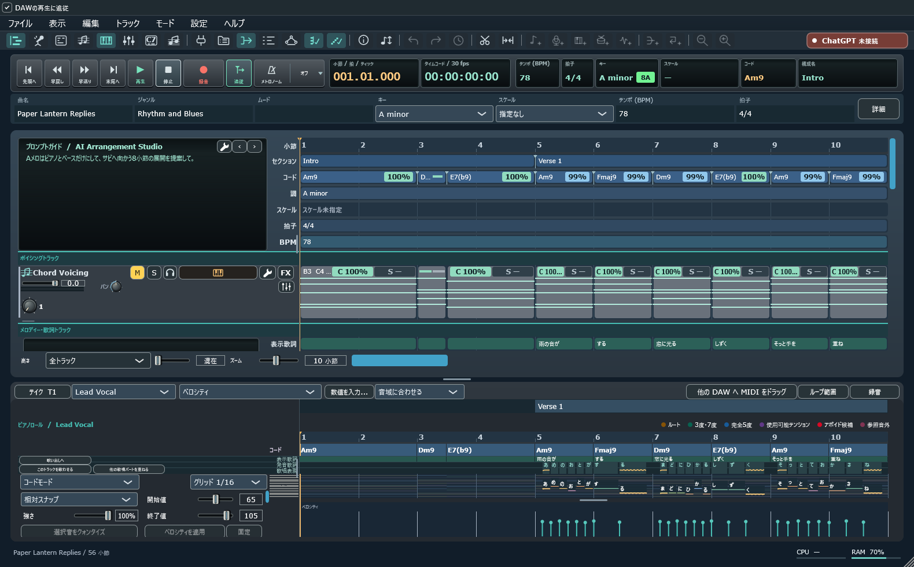
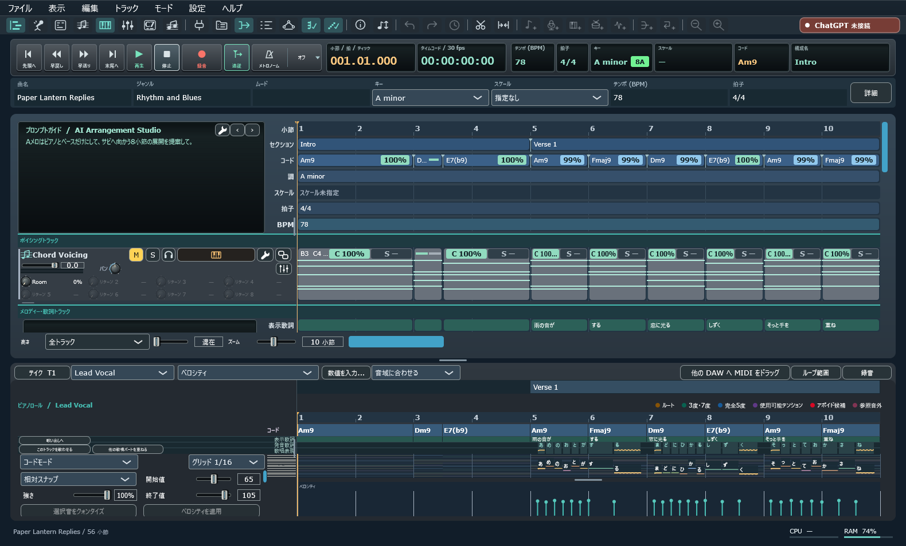

# OSTF Studio 操作マニュアル

[English](en.md) · [プラグイン図鑑](../plugins/README.md) · [リポジトリのトップ](../../README.ja.md)

## 普段のDAWでデモ曲を鳴らす

Ableton LiveやCubaseを普段使っている方は、そのDAWのインストゥルメントトラックに **OSTF Studio** をVST3として挿してください。Studioでコードや歌詞を編集しながら、普段のDAWで他のトラックを録音・ミックスできます。

**対象バージョン**　Studio本体を読み込めるVST3は、公開アルファ1の**次の開発版**で追加されました。公開アルファ1で試す場合は、Studioを単体で開くか、同梱のScale EditorやFormant SingerをDAWに直接挿せます。[各プラグインの画面を見る](../plugins/README.md)

1. **インストールする。** 対応するWindows開発版のセットアップを開きます。初期状態は全選択です。デモで試すなら「他のDAWで使う Studio VST3（デモ曲の音源・エフェクト付き）」を選べます。手動で選ぶ場合の項目名は **OSTF Studio (VST3)** です。
2. **DAWに挿す。** VST3を再スキャンし、インストゥルメント一覧で **OSTF Studio** を検索します。Ableton LiveではブラウザーからMIDIトラックにドラッグします。Cubaseでは「トラックを追加 → インストゥルメント」で音源に選びます。[LiveのVST3設定](https://help.ableton.com/hc/en-us/articles/209071729-Using-VST-plug-ins-on-Windows) · [Cubaseのトラック追加](https://www.steinberg.help/r/cubase-pro/16.0/en/cubase_nuendo/topics/tracks_about/tracks_about_add_track_instrument_settings_r.html)
3. **プラグインの中で曲を開く。** Studioの **ファイル → デモソング → Paper Lantern Replies** を選びます。手持ちの曲なら、同じファイルメニューから `.ostfp` または `.ostf` を開きます。
4. **DAWを先頭から再生する。** プラグイン左上の **DAWの再生に追従** をオンにします。Studioのミックスが、そのトラックのステレオ出力に返ります。歌が入るのは5小節目です。曲を単独で試聴するときは追従を外し、Studioの再生ボタンを使います。

追従するのはホストの再生・停止と時間位置です。StudioはOSTFに記録されたテンポを使います。他のトラックと小節の頭を揃えるには、ホスト側のテンポも曲に合わせます。このデモの冒頭は **78 BPM、4/4拍子** です。

## 曲のコードにスケールを設定する

開発版では、**OSTF Studio内の音源トラック**に **OSTF Scale Editor** をセットします。他のDAWでは、先に **OSTF Studio (VST3)** を立ち上げ、その中で曲を開きます。左ペインでコードを選び、候補を試聴して **スケールを設定** を押すと、左のコードに確定したスケール名とチェックが付きます。書き込み先が **和声** ならStudioのグローバルスケールレーンに、トラックならそのトラックのスケール指定に反映されます。曲はStudioまたは親DAWで保存します。

DAW用のインストール構成を選んだ場合は、作曲支援の一覧で **OSTF Scale Editor** にもチェックを付けてください。

## Studio単体で始める

アプリの **OSTF Studio** を起動し、**設定** からオーディオ／MIDIデバイスの出力先を選びます。**ファイル → デモソング** で曲を選んで再生してください。音源やエフェクトを追加するには、プラグインブラウザーでVST3をスキャンし、音源をトラックの音源枠へ、エフェクトをFX枠へドラッグします。

### アレンジとミキサー

アレンジ上部の構成・コード・調・スケールは全トラックで共有します。MIDIクリップを選び、下段のピアノロールで音符をドラッグすると高さや開始位置を変えられます。オーディオクリップを選ぶと、同じ場所に波形と音程が現れます。波形をダブルクリックしてワープマーカーを追加し、左右に動かすとタイミングを調整できます。単音の音程は下段の音を上下にドラッグします。

ミキサーでは **M** でミュート、**S** でソロを切り替えられます。鍵盤で演奏するトラックの **IN** で入力を選び、**R** で録音待機にします。エフェクトを探すときは、目的別の図鑑から音の変わり方と最初に触るパラメーターを確認できます。[プラグイン図鑑](../plugins/README.md)

### ライブセッションで別の演奏を試す

行が曲の構成、列がトラックです。構成の行で各トラックのMIDIテイクを選び、演奏回数を決めてキューに追加します。演奏する人は画面上のコード表示で次の和音を確認できます。気に入ったテイクを採用すると、同じ曲のアレンジにも反映されます。[テイクとキューの詳しい操作](../TAKES_AND_LIVE_SESSION.ja.md)

### 譜面とPDF

リードシートでコードと表示歌詞を確認し、パート譜では譜面にしたいトラックを選びます。**印刷プレビュー**で用紙、余白、改ページ、小節番号、曲に登録したクレジットの表示項目を選び、**PDFを保存**で書き出します。

## 何を保存すればよいか

| やりたいこと | 保存先 |
| --- | --- |
| いつものDAWで作業を再開する | ホストDAWのプロジェクトを保存します。Studio VST3の曲と音源・FXの状態も復元対象です。 |
| Studio単体で再開する、別のPCへ制作状態を渡す | Studio内で **OSTFPプロジェクト** を保存します。受け取り側にも使用したVST3と必要な外部音源ライブラリーを用意します。 |
| 構成、コード、音符、歌詞を他のOSTF対応ツールに渡す | Studio内で **OSTFスコア** を保存します。Scale Editorで編集したときは、Scale Editor側でそのスコアを保存します。 |

## 音が出ないとき

- **DAWにStudioが見つからない** — 使用版に **OSTF Studio (VST3)** が含まれるかを確認します。Windowsのインストール先は `C:\Program Files\Common Files\VST3\OSTF Studio` です。DAWのVST3システムフォルダーを有効にし、再スキャンしてからインストゥルメント一覧を開きます。
- **画面は開くがデモが動かない** — ホストの再生位置を曲頭に戻し、**DAWの再生に追従** とホストの再生状態を確認します。
- **曲は進むが無音** — Studio内のトラックに音源が入っているか、Studioのマスターとホスト側のトラックメーターがそれぞれ振れるかを順に確認します。デモ用の音源・FXも同じPCにインストールしてください。
