# OSTF Studio user manual

[日本語](README.md) · [Illustrated plug-in guide](../plugins/en.md) · [Project home](../../README.md)

Public Alpha 2 includes standalone Studio and 41 VST3s. The illustrations show the Windows development build. Where the controls differ, follow the instructions for your version.

## Play a song inside your usual DAW

If you work in Ableton Live, Cubase or another VST3 host, load **OSTF Studio** as an instrument on a track in that DAW. You can edit the score inside Studio and record or mix the rest of the production in your host.

1. **Install the workstation instrument.** In the Windows Public Alpha 2 installer, all components start selected. Choose **Studio VST3 for another DAW** for the workstation and the instruments and effects used in the demo. The individual workstation checkbox is **OSTF Studio (VST3)**.
2. **Create an instrument track.** Rescan VST3s in your host and search for **OSTF Studio** in its instrument browser. In Ableton Live, drag it from the browser to a MIDI track. In Cubase, open **Add Track → Instrument** and select it as the instrument. [Ableton VST3 setup](https://help.ableton.com/hc/en-us/articles/209071729-Using-VST-plug-ins-on-Windows) · [Cubase instrument tracks](https://www.steinberg.help/r/cubase-pro/16.0/en/cubase_nuendo/topics/tracks_about/tracks_about_add_track_instrument_settings_r.html)
3. **Open the song inside the plug-in.** Choose **File → Demo songs → Paper Lantern Replies**, or open your own `.ostfp` project or `.ostf` score.
4. **Start your DAW at the beginning.** Enable **Follow DAW transport** at the top left of the plug-in. Studio sends a stereo mix to the host track. The lead vocal enters at bar 5. To audition with Studio’s own transport, turn follow off.

The plug-in follows the host’s play, stop and time position. Studio reads tempo changes from the OSTF score. To line up bars with other tracks, match the host tempo map to the song. This demo starts at **78 BPM in 4/4**.

## Edit a global lane boundary (development build)

Split a section, chord, key, scale or meter interval to expose a triangular handle. Drag it with the pointer or scissors tool. Sections and meters snap to bars, keys to beats, and chords and scales to half beats.

Right-click a boundary, or select it and press Delete. Choose **Keep earlier value** or **Keep later value**. For example, keeping the later value at a 4/4 to 3/4 boundary extends 3/4 into the preceding interval. Notes retain their tick positions and lengths. Audio placement and tempo events stay in place. The musical bar and beat count changes. Undo restores the boundary. Pasting into an existing section, chord, key, scale or meter interval replaces its value and keeps its two edges.

## Assign a scale to the project

In Public Alpha 2, load **OSTF Scale Editor** on an instrument track **inside OSTF Studio**. In another DAW, load **OSTF Studio (VST3)** first and open the project there. Choose a chord in the left pane, audition candidates, then choose **Set scale**. The check mark and scale name show the assignment for the selected target. **Harmony** updates Studio’s global scale lane. A pitched track receives its own scale direction. Save the project in Studio or in the DAW containing it.

In the Windows development build, open **wrench → OSTF Scale Editor** on a MIDI track to audition through its assigned instrument. For shared harmony you can also open it from the wrench beside the prompt guide arrows.

If you choose the DAW installer preset, also select **OSTF Scale Editor** under **Composition**.

Choose the section in the header, then click **Play section**, or use **Play song** to start from the beginning. The header shows the sounding scale. A completely unassigned range plays suggested scales. A gap between saved assignments stays silent. In Public Alpha 2, to check the audio route, select the reference tone or an instrument in the header and play a test note.

## Start in standalone Studio

Open the Studio application, choose your audio output under **Settings**, then choose a project under **File → Demo songs** and press Play. To add devices, scan VST3s in the plug-in browser and drag an instrument or effect to the corresponding mixer slot.

In the development build, select **Plug-ins → OSTF Tools** to show devices marked with a blue wrench. In a narrow browser the button reads **Tools**. You can also choose a manufacturer or enter a search term, then drag the tool onto a compatible MIDI track.

### Reorder and bypass effects (Windows development build)

Open **FX** on a track to see its signal path from top to bottom. Drag a slot by the left grip to move it. Bypassing a slot lights its amber indicator and changes the button label. A processor with a sidechain input has a key selector on its rack unit.

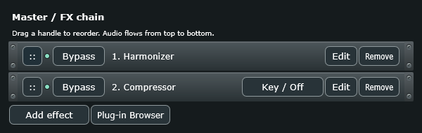

### Try a phrase in a different take (Windows development build)

In a track header, the keyboard opens the instrument slot, the wrench opens OSTF Tools, **FX** opens the effect chain and the faders open mix settings. Drop Scale Editor on the scale or chord lane, then open it from the wrench beside the prompt guide arrows. The voicing and audio track wrenches list tools compatible with those tracks.

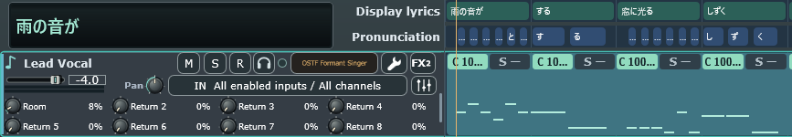

1. Open the take you want on a pitched MIDI track with an instrument assigned. Select a phrase in its piano roll.
2. Open **OSTF Motif Expander** from that track’s wrench and capture the selection. Generate a variation and listen to both versions. For an AI variation, the tool window’s title bar gives access to Studio’s shared AI connection.
3. Choose **New take here** to keep both performances at the same position. Their lanes appear below the source track, with **Adopted** on the current performance. To place the phrase later, move the cursor to an empty span on the destination track and take, then choose **Place at cursor**. Use this placement to write a variation of a lyric-linked phrase as MIDI.

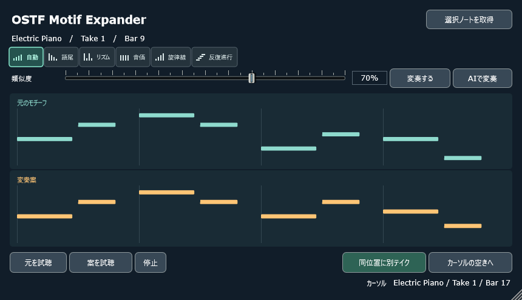

In Velocity Shaper, choose a section and take, balance its overall level, then shape the entrance and ending. Click a bar number for its rhythmic accent, or select the specific chord change. The prompt guide supplies editable AI examples. Audition the result before applying. Guitar Voicer compares fret positions and Note Split creates repeated notes. [See the tool controls](../plugins/workstations.en.md#ostf-velocity-shaper)

For a harmony part, select root notes and use **Chord Trigger**. For a beat, place the cursor in the destination bar and use **Rhythm Generator** on a pitched or drum track. To tighten an existing performance, select the notes and use **Quantize**. Each tool previews its edits and writes them to the score when you press **Apply**. One Undo reverses the whole edit. [MIDI tool controls](../plugins/workstations.en.md#ostf-chord-trigger)

### Balance a phrase’s dynamics (Windows development build)

To lift quiet notes or tame loud accents, select the phrase in the take you are editing. Open **OSTF Velocity Range** from the track wrench and read the selection. For example, with a floor of 60 and a ceiling of 100, a velocity of 45 rises to 60, 112 falls to 100, and 80 stays at 80.

Review the change count, then press **Apply**. One Undo restores the original values. For uniform hits, set the start velocity in the piano roll and press **Fixed**. For a crescendo across a section, shape its entry and ending with [Velocity Shaper](../plugins/workstations.en.md#ostf-velocity-shaper).

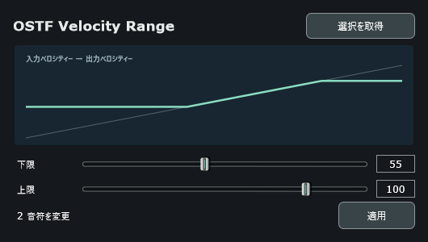

### Arrangement and mixer

The section, chord, key and scale lanes apply across tracks. Select a MIDI clip to open the piano roll below the arrangement. Drag a note to change its pitch or start time. For audio clips, the lower editor shows the waveform and detected pitches.

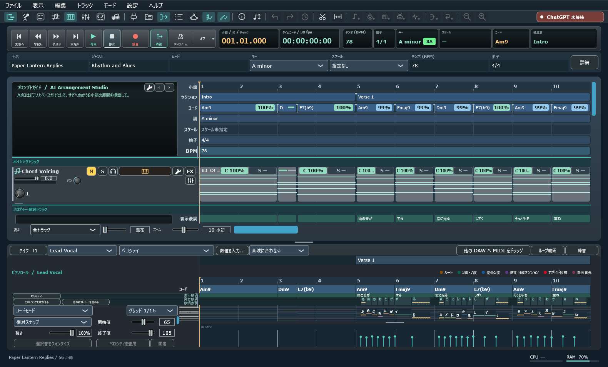

Use **M** to mute a mixer strip and **S** to solo it. To play a track from a keyboard, select its **IN** source and arm it with **R**. The illustrated guide lists the instruments you can put on a track and the effects you can insert after them. [Browse the plug-ins](../plugins/en.md)

### Edit audio timing and pitch

On an audio clip, double-click the upper waveform to add a warp marker and drag sideways to change its timing. Select a detected note below the waveform, then drag vertically or use the semitone buttons. **Reset pitch** restores that note. Pitch edits apply to the selected clip. **Link aligned stems** shares timing edits with matching clips.

### Enter a chord or scale

Click the region you want in the **Chord** lane. The lower editor opens on that chord. Choose its root, quality and optional bass note. Click the **Scale** lane at the same position to edit the scale instead. Choose a tonic and preset, then apply it. When a saved scale spans several chords, use **This chord only** to change one chord while preserving the rest.

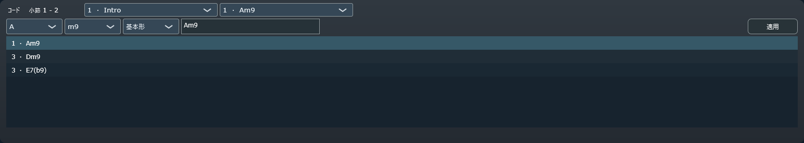

| Lane | Where a shared boundary snaps |
| --- | --- |
| Section and meter | Bar line |
| Key | Beat |
| Chord and scale | Half beat |

Split a region with the scissors, turn the scissors off, then drag the shared edge left or right. The adjoining regions resize together. To add time, right-click a global lane and choose the number of bars to insert before the clicked bar. Split a repeating MIDI clip first if the insertion falls inside it. Bar insertion is restricted for scores with authored notation or musical time maps.

Select an arrangement clip and press **Ctrl+A** (**⌘A** on Mac) to select all clips. To move a selection together, right-click it and choose the command to move it to the cursor. Relative spacing is preserved, including the takes and comp ranges of a selected take group.

### Set a drum loop on the ruler

In the drum step editor, drag across the bar ruler to mark the range. Drag the left handle to change the first bar or the right handle to change the last. Check **Loop** and the displayed range. Zoom out in the piano roll to see more bars on the shared time axis.

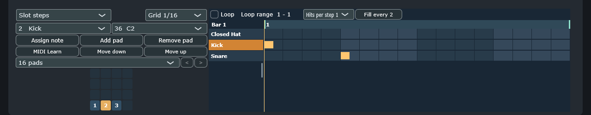

### Compare takes in Live Session

Rows are song sections and columns are tracks. Pick MIDI takes for a section, set its play count and add the combination to the queue. Performers can follow the chord display above the grid. Adopting a take updates the arrangement for the same song.

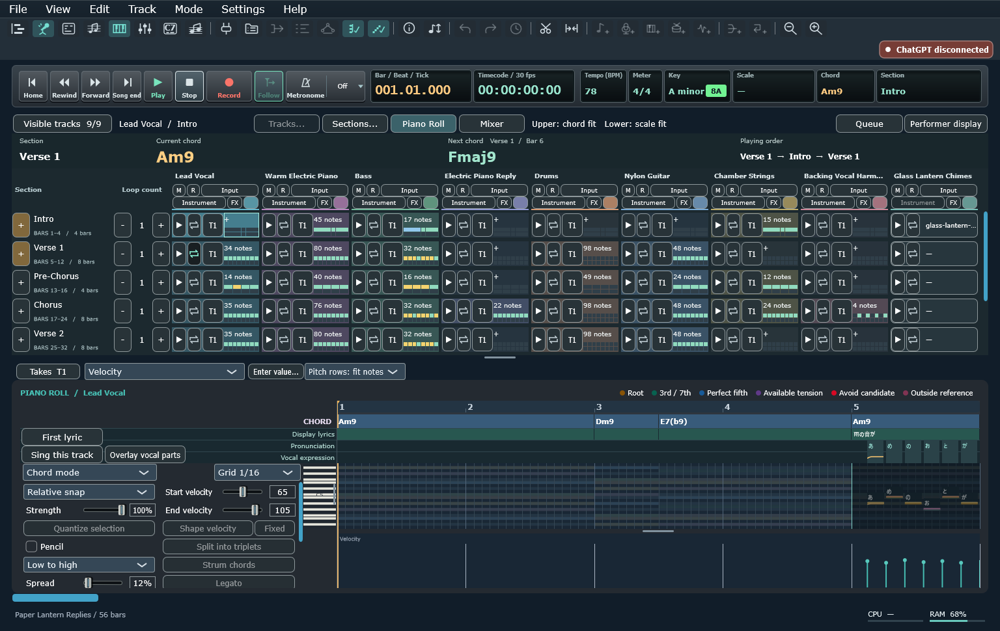

### Read and print a part

Use the lead sheet to read chords and lyrics, or select a track in the score view to read its part. Open **Print preview**, choose the paper, margins, page breaks and stored credits to show, then select **Save PDF**.

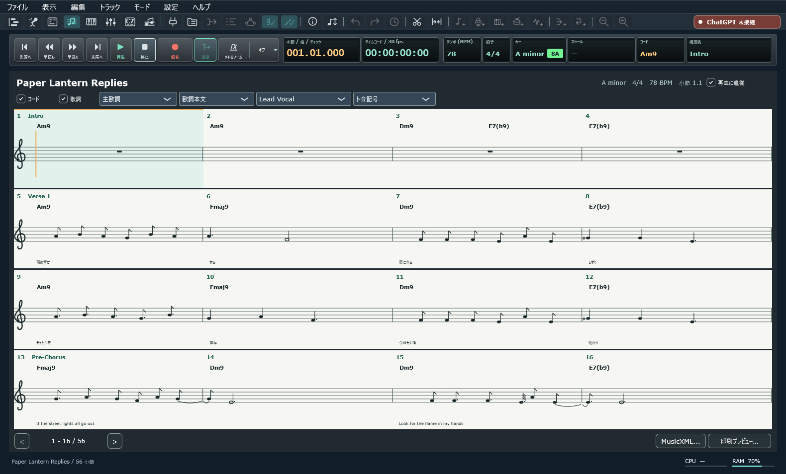

Open **Score** and click **Piano Roll** in the top toolbar. Picking a part in the score updates the editor below it. Move or draw a note in the piano roll to update the staff. Click **Piano Roll** again for a full-height score.

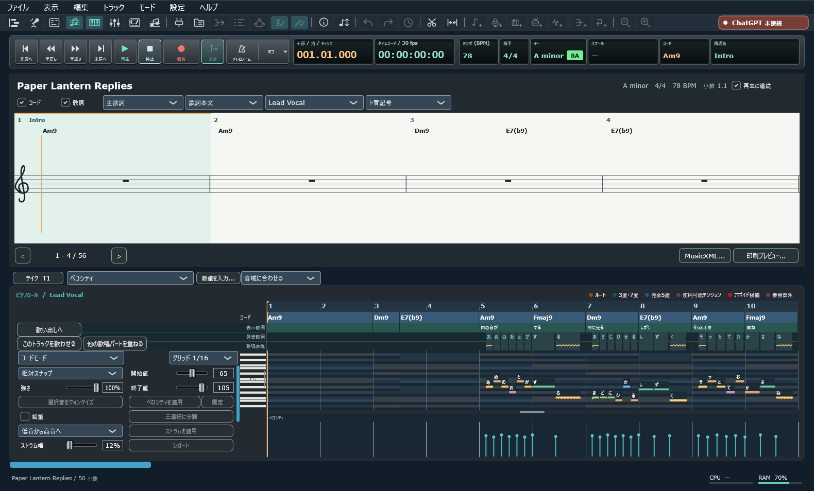

## Choose a save format

| What you want to keep | Where to save |
| --- | --- |
| The session in your usual DAW | Save the **host DAW project**. It stores Studio’s song and device state with the plug-in instance. |
| A Studio production to reopen or move | Save an **OSTFP project** from Studio. The destination computer also needs the VST3s and any external sound libraries used by the project. |
| The musical score to exchange with another tool | Save an **OSTF score** in Studio. In Public Alpha 2 this includes the scales you assigned in Scale Editor. |

## If you hear silence

- **Studio is missing from the instrument browser.** Check that your build includes **OSTF Studio (VST3)**. Windows Setup installs it under `C:\Program Files\Common Files\VST3\OSTF Studio`. Enable the system VST3 folder in the host and rescan.
- **The song position does not move.** Return the DAW to the song start and check **Follow DAW transport** and the host Play button.
- **The timeline moves but the track is silent.** Check instrument assignments in Studio, then the Studio master meter and the host track’s stereo output in order. Install the demo’s instruments and effects on the same computer.

## Export audio and bounce a track (Public Alpha 2)

Choose **File → Export mix as audio** to render the arrangement from its beginning. Choose a format, sample rate and bit depth or encoding rate. **Effect tail after song end** keeps up to 30 seconds of reverb and delay. The stereo file includes track inserts, buses, returns and the master. Record an external MIDI instrument to an audio track before exporting its sound.

WAV supports 16/24-bit PCM and 32-bit float. AIFF and FLAC offer 16/24-bit PCM. Ogg Vorbis and Opus offer encoding quality choices. Windows uses Media Foundation for MP3 and AAC (.m4a). macOS uses the system AAC converter and offers MP3 when LAME is installed in a standard Homebrew location.

Click a track name, then Ctrl-click (Command-click on macOS) other track names. Shift-click selects a contiguous range. Right-click a selected header and choose **Bounce tracks to one audio track**. The number beside the command is the number of source tracks. The piano roll keeps its editing focus while you extend the selection. A single source prints its instrument and inserts before its fader. Multiple sources are summed with their strip levels and pan before bus and master processing.

To render an excerpt, select the clip in the arrangement and right-click it. Ctrl/Cmd-click additional clips to select passages across tracks. The new audio starts at the earliest selected clip and ends at the last selected clip boundary. Gaps keep their original duration. The new 48 kHz, 24-bit track starts muted. Save the project as OSTFP to keep its audio.

## Mixer, song information and AI prompts

Open **Mixer** to see the track instruments, inserts, sends, output routing and master. Set the input and arm each track you want to play or record.

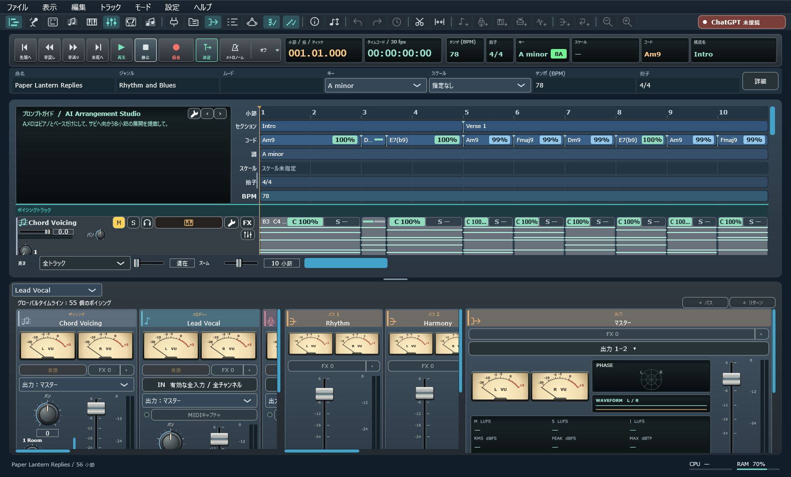

**Windows development build.** The arrangement shows a knob and number for each configured return. Match the number to the mixer return strip to see its name and the send percentage. Each mixer track has separate full-width input and output selectors. MIDI Capture sits below the routes on MIDI tracks.

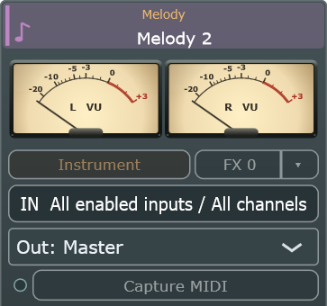

Open **Details** beside the song information strip to edit the song and its credits. Print preview lets you select which of the stored credits to display.

Use the **Mode** menu to choose arrangement, lyric or vocal work. The prompt guide beside the timeline changes with the mode. Use its arrows to read another example. The toolbar shows the ChatGPT connection status. When working with an external AI, choose the OSTF material to share and review the result before importing it.

## DAWproject exchange

In the development build, choose **File → Import DAWproject** or drop a `.dawproject` file onto Studio. Embed the audio when exporting from the source DAW. Studio reads WAV, AIFF and FLAC and converts the latter two to WAV. Studio opens a new editable arrangement. Use **Save as OSTFP** to keep the converted song and its audio together.

Choose **File → Export DAWproject** to send the arrangement to another DAW. MIDI parts retain their clip positions, note lengths, channels and velocities. The exchange also carries track names and colours, volume, pan, mute and solo, section markers, meter and stepped tempo changes. Pan automation supports both linear transitions and held values. Imported loops and linked clips become editable clip instances. Audio with Studio pitch, warp or loop edits is rendered into an embedded WAV so the recipient hears those edits.

Assign an instrument to each MIDI track in the receiving DAW. Keep the native project for device states, bus routing, take selection, lyrics and chord/scale editing. The conversion report identifies omitted features. Studio accepts up to 15 source tracks and mono or stereo embedded WAV files up to 16 MiB each and 64 MiB combined. Split hybrid note/audio tracks in the source DAW. [DAWproject 1.0 specification](https://github.com/bitwig/dawproject)
