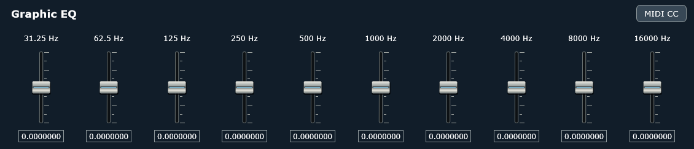
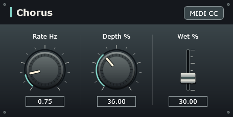
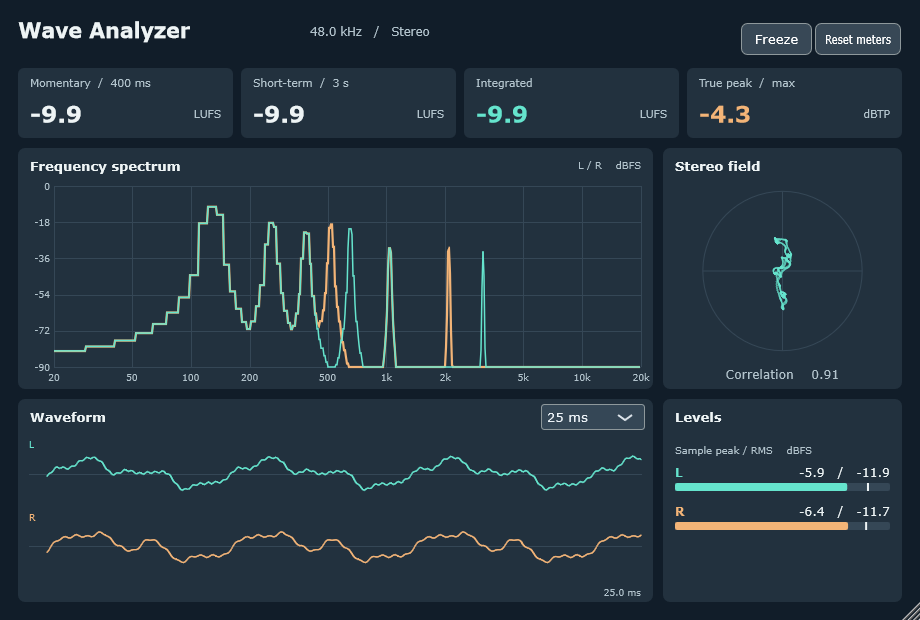

# プラグイン図鑑

[English](en.md) · [Studio操作マニュアル](../manual/README.md)

同梱VST3を用途から探せます。各項目に実際の操作画面と、最初に試す操作を載せました。公開アルファ1の38個に加え、開発版ではワークステーション音源 **OSTF Studio** とリードシンセ **SUPER KNOBBER LEAD** が使えます。

## [作曲ツールと音源 (10)](workstations.md)

[OSTF Studio](workstations.md#ostf-studio) · [OSTF Scale Editor](workstations.md#ostf-scale-editor) · [GM Sound Module](workstations.md#gm-sound-module) · [OSTF Formant Singer](workstations.md#ostf-formant-singer) · [FM Synth](workstations.md#fm-synth) · [Analog Synth](workstations.md#analog-synth) · [Wavetable Synth](workstations.md#wavetable-synth) · [Drum Machine](workstations.md#drum-machine) · [Instrument Rack](workstations.md#instrument-rack) · [SUPER KNOBBER LEAD](workstations.md#super-knobber-lead)

## [EQ・フィルター・ダイナミクス (16)](eq-dynamics.md)

[EQ](eq-dynamics.md#eq) · [Parametric EQ](eq-dynamics.md#parametric-eq) · [8-Band EQ](eq-dynamics.md#8-band-eq) · [Graphic EQ](eq-dynamics.md#graphic-eq) · [Dynamic EQ](eq-dynamics.md#dynamic-eq) · [Filter](eq-dynamics.md#filter) · [High-Pass Filter](eq-dynamics.md#high-pass-filter) · [Low-Pass Filter](eq-dynamics.md#low-pass-filter) · [Compressor](eq-dynamics.md#compressor) · [Bus Compressor](eq-dynamics.md#bus-compressor) · [Multiband Compressor](eq-dynamics.md#multiband-compressor) · [Multiband Bus Compressor](eq-dynamics.md#multiband-bus-compressor) · [Limiter](eq-dynamics.md#limiter) · [Gate](eq-dynamics.md#gate) · [De-Esser](eq-dynamics.md#de-esser) · [Unmask](eq-dynamics.md#unmask)

## [空間・モジュレーション・ギター・ラック (12)](space-and-tone.md)

[Reverb](space-and-tone.md#reverb) · [Delay](space-and-tone.md#delay) · [Chorus](space-and-tone.md#chorus) · [Phaser](space-and-tone.md#phaser) · [Flanger](space-and-tone.md#flanger) · [Harmonizer](space-and-tone.md#harmonizer) · [Distortion](space-and-tone.md#distortion) · [Guitar Amp](space-and-tone.md#guitar-amp) · [Electric Guitar Rig](space-and-tone.md#electric-guitar-rig) · [Acoustic Guitar Rig](space-and-tone.md#acoustic-guitar-rig) · [Bass Rig](space-and-tone.md#bass-rig) · [Effect Rack](space-and-tone.md#effect-rack)

## [解析・素材の取り出し (2)](analysis.md)

[Wave Analyzer](analysis.md#wave-analyzer) · [Stem Separator](analysis.md#stem-separator)
