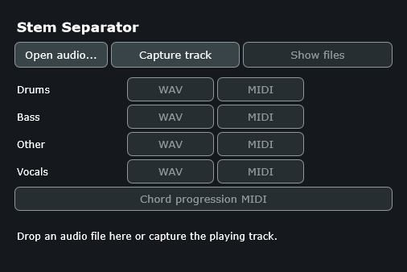

# Analysis and stem extraction

[日本語](analysis.md) · [All plug-ins](en.md) · [Studio user manual](../manual/en.md)

Inspect a mix visually or extract material from recorded audio for further editing.

[Wave Analyzer](#wave-analyzer) · [Stem Separator](#stem-separator)

## Wave Analyzer

Shows waveform, spectrum, stereo field, loudness and true peak. Insert it last on the master, play a passage, then use **Freeze** to inspect a moment.

The screenshot shows a stereo signal being measured. Read the loudness and true peak across the top, compare frequency peaks and stereo spread in the middle, then follow the waveform below.

## Stem Separator

Estimates drums, bass, other and vocals from a recording. Drop a file or use **Capture track** and **Finish capture**, then drag the resulting **WAV** or **MIDI** onto a track. Some sounds can bleed between the estimated stems.

[Return to the plug-in guide](en.md)
