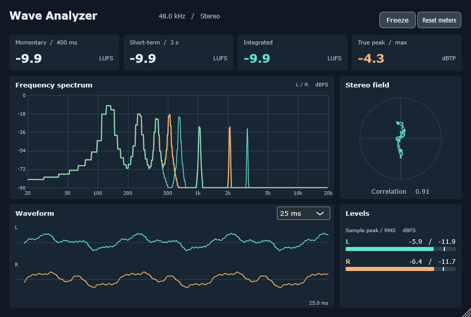
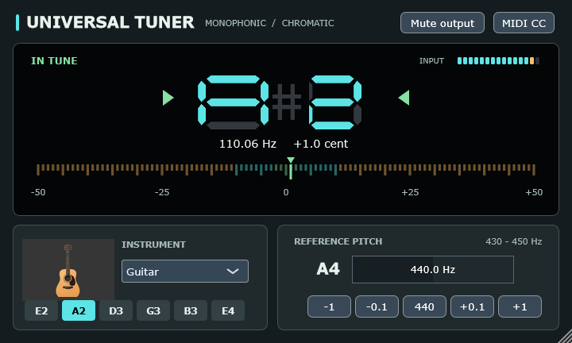
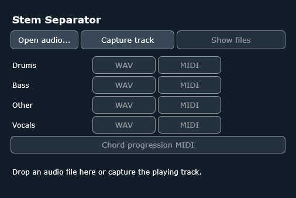

# 解析・素材の取り出し

[English](analysis.en.md) · [図鑑の目次](README.md) · [Studio操作マニュアル](../manual/README.md)

ミックスの状態を目で確かめたいとき、または録音から素材を取り出して編集したいときに使います。

[Wave Analyzer](#wave-analyzer) · [Universal Tuner](#universal-tuner) · [Stem Separator](#stem-separator)

## Wave Analyzer

波形、スペクトル、ステレオの広がり、ラウドネス、トゥルーピークを同時に確認できます。マスターの最後に挿して曲を再生し、気になる瞬間に **Freeze** で表示を止めます。

下の画像はステレオ信号の解析中です。上段でラウドネスとトゥルーピーク、中央で周波数の山と左右の広がり、下段で波形の時間変化を読めます。

## Universal Tuner

**Windows開発版**

オーディオトラックのFXに挿し、入力モニターを有効にして一音ずつ弾きます。ソフト音源では音源の後ろに挿します。音名の下に実測周波数とセント差が出ます。左に振れたら低め、右なら高めです。中央から±2セント以内で **IN TUNE** が点灯します。

**Instrument** で楽器を選ぶと、ギターやベース、弦楽器では標準調弦の開放弦が下に並び、検出した音名とオクターブに合う弦が光ります。別の調弦や歌声にはクロマチック表示も使えます。**Reference Pitch** は430.0～450.0 Hzで設定でき、**440** で標準に戻せます。

ライブで客席に調律音を出したくないときは、**Mute output** をオンにすると、入力の音程を測りながらこのトラックの出力を消せます。演奏に戻る前にもう一度押してください。

## Stem Separator

録音からドラム、ベース、その他、ボーカルを推定してWAVに取り出します。ファイルをドロップするか、**Capture track** で区間を収録し、結果の **WAV** や **MIDI** をトラックへドラッグします。分離音には他のパートが残ることがあります。

[プラグイン図鑑の目次に戻る](README.md)
