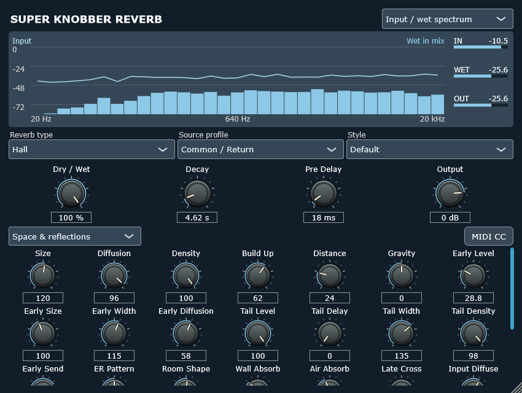

# Illustrated plug-in guide

[日本語](README.md) · [Studio user manual](../manual/en.md)

Browse the bundled VST3s by what you want to do. Each entry shows the editor and suggests a first control to try. Public Alpha 1 includes 38 tools. The development build adds the OSTF Studio workstation, SUPER KNOBBER LEAD synthesizer and SUPER KNOBBER REVERB stereo effect.

**All 41 screenshots come from the Windows development build.** To edit a Studio song inside another DAW, load OSTF Studio on an instrument track and open Scale Editor inside it. To use a single effect such as an EQ or reverb, insert it directly in your DAW’s effect slot. [Set up the workstation in another DAW](../manual/en.md#studio-vst3)

## [Composition and instruments (10)](workstations.en.md)

[OSTF Studio](workstations.en.md#ostf-studio) · [OSTF Scale Editor](workstations.en.md#ostf-scale-editor) · [GM Sound Module](workstations.en.md#gm-sound-module) · [OSTF Formant Singer](workstations.en.md#ostf-formant-singer) · [FM Synth](workstations.en.md#fm-synth) · [Analog Synth](workstations.en.md#analog-synth) · [Wavetable Synth](workstations.en.md#wavetable-synth) · [Drum Machine](workstations.en.md#drum-machine) · [Instrument Rack](workstations.en.md#instrument-rack) · [SUPER KNOBBER LEAD](workstations.en.md#super-knobber-lead)

## [EQ, filtering and dynamics (16)](eq-dynamics.en.md)

[EQ](eq-dynamics.en.md#eq) · [Parametric EQ](eq-dynamics.en.md#parametric-eq) · [8-Band EQ](eq-dynamics.en.md#8-band-eq) · [Graphic EQ](eq-dynamics.en.md#graphic-eq) · [Dynamic EQ](eq-dynamics.en.md#dynamic-eq) · [Filter](eq-dynamics.en.md#filter) · [High-Pass Filter](eq-dynamics.en.md#high-pass-filter) · [Low-Pass Filter](eq-dynamics.en.md#low-pass-filter) · [Compressor](eq-dynamics.en.md#compressor) · [Bus Compressor](eq-dynamics.en.md#bus-compressor) · [Multiband Compressor](eq-dynamics.en.md#multiband-compressor) · [Multiband Bus Compressor](eq-dynamics.en.md#multiband-bus-compressor) · [Limiter](eq-dynamics.en.md#limiter) · [Gate](eq-dynamics.en.md#gate) · [De-Esser](eq-dynamics.en.md#de-esser) · [Unmask](eq-dynamics.en.md#unmask)

## [Space, modulation, guitars and racks (13)](space-and-tone.en.md)

[Reverb](space-and-tone.en.md#reverb) · [Delay](space-and-tone.en.md#delay) · [Chorus](space-and-tone.en.md#chorus) · [Phaser](space-and-tone.en.md#phaser) · [Flanger](space-and-tone.en.md#flanger) · [Harmonizer](space-and-tone.en.md#harmonizer) · [Distortion](space-and-tone.en.md#distortion) · [Guitar Amp](space-and-tone.en.md#guitar-amp) · [Electric Guitar Rig](space-and-tone.en.md#electric-guitar-rig) · [Acoustic Guitar Rig](space-and-tone.en.md#acoustic-guitar-rig) · [Bass Rig](space-and-tone.en.md#bass-rig) · [Effect Rack](space-and-tone.en.md#effect-rack) · [SUPER KNOBBER REVERB](space-and-tone.en.md#super-knobber-reverb)

## [Analysis and stem extraction (2)](analysis.en.md)

[Wave Analyzer](analysis.en.md#wave-analyzer) · [Stem Separator](analysis.en.md#stem-separator)
