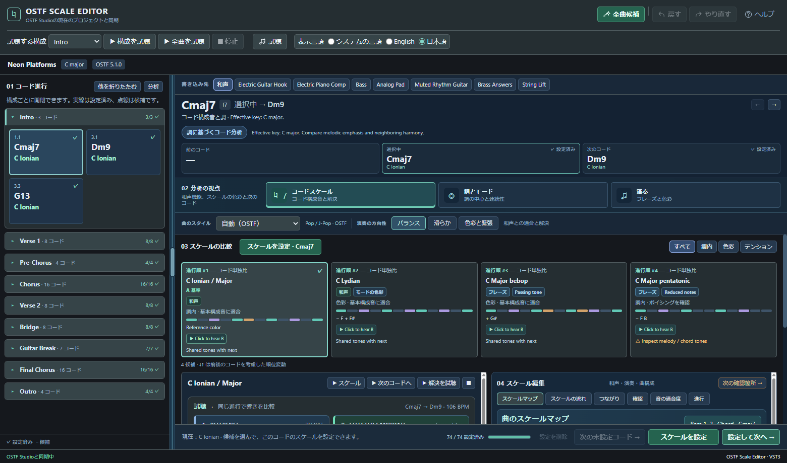
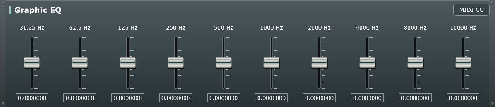
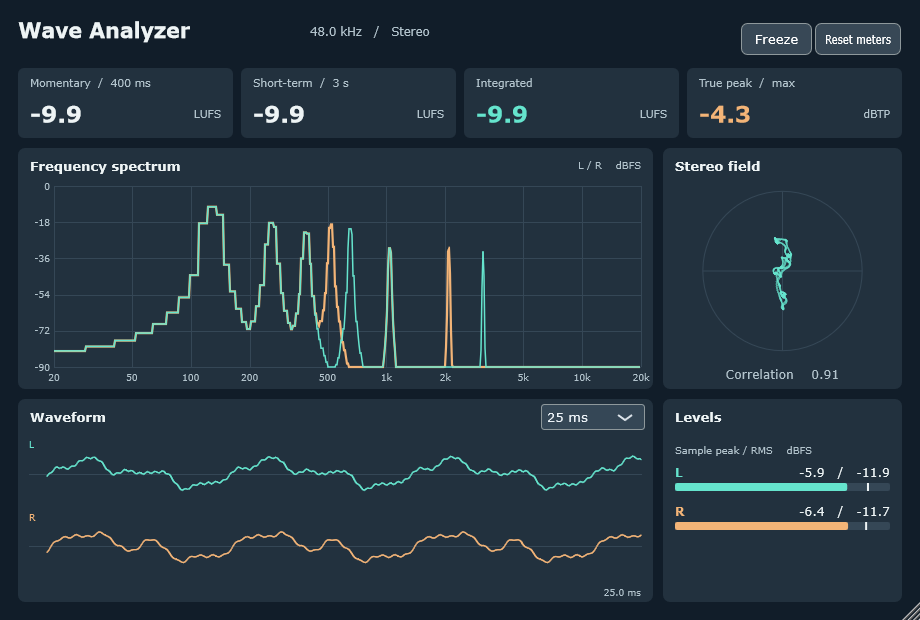

# Illustrated plug-in guide

[日本語](README.md) · [Studio user manual](../manual/en.md)

Explore the 41 VST3s in Public Alpha 2 and fourteen additions in the Windows development build. Each entry shows the editor and a first control to try.

In another DAW, load an instrument on an instrument track or put a reverb or tuner in an audio effect slot. To edit a Studio project’s notes and takes, load **OSTF Studio (VST3)** in your DAW and open its tools inside the workstation. [Set up Studio in another DAW](../manual/en.md#studio-vst3)

To try the new MIDI tools, start with [Velocity Range](workstations.en.md#ostf-velocity-range) for dynamics, [Arpeggiator](workstations.en.md#ostf-arpeggiator) for held chords or [Rhythm Generator](workstations.en.md#ostf-rhythm-generator) for pulses. Each of the fourteen additional devices carries a **Windows development preview** label.

## [Composition and instruments (23)](workstations.en.md)

[OSTF Studio](workstations.en.md#ostf-studio) · [OSTF Scale Editor](workstations.en.md#ostf-scale-editor) · [OSTF Velocity Shaper](workstations.en.md#ostf-velocity-shaper) · [OSTF Guitar Voicer](workstations.en.md#ostf-guitar-voicer) · [OSTF Note Split](workstations.en.md#ostf-note-split) · [OSTF Motif Expander](workstations.en.md#ostf-motif-expander) · [GM Sound Module](workstations.en.md#gm-sound-module) · [OSTF Formant Singer](workstations.en.md#ostf-formant-singer) · [FM Synth](workstations.en.md#fm-synth) · [Analog Synth](workstations.en.md#analog-synth) · [Wavetable Synth](workstations.en.md#wavetable-synth) · [Drum Machine](workstations.en.md#drum-machine) · [Instrument Rack](workstations.en.md#instrument-rack) · [SUPER KNOBBER LEAD](workstations.en.md#super-knobber-lead) · [SUPER KNOBBER PAD](workstations.en.md#super-knobber-pad) · [SUPER KNOBBER PIANO](workstations.en.md#super-knobber-piano) · [OSTF Chord Trigger](workstations.en.md#ostf-chord-trigger) · [OSTF Rhythm Generator](workstations.en.md#ostf-rhythm-generator) · [OSTF Quantize](workstations.en.md#ostf-quantize) · [OSTF Arpeggiator](workstations.en.md#ostf-arpeggiator) · [OSTF Velocity Range](workstations.en.md#ostf-velocity-range) · [OSTF Legato](workstations.en.md#ostf-legato) · [SUPER KNOBBER ORGAN](workstations.en.md#super-knobber-organ)

## [EQ, filtering and dynamics (16)](eq-dynamics.en.md)

[EQ](eq-dynamics.en.md#eq) · [Parametric EQ](eq-dynamics.en.md#parametric-eq) · [8-Band EQ](eq-dynamics.en.md#8-band-eq) · [Graphic EQ](eq-dynamics.en.md#graphic-eq) · [Dynamic EQ](eq-dynamics.en.md#dynamic-eq) · [Filter](eq-dynamics.en.md#filter) · [High-Pass Filter](eq-dynamics.en.md#high-pass-filter) · [Low-Pass Filter](eq-dynamics.en.md#low-pass-filter) · [Compressor](eq-dynamics.en.md#compressor) · [Bus Compressor](eq-dynamics.en.md#bus-compressor) · [Multiband Compressor](eq-dynamics.en.md#multiband-compressor) · [Multiband Bus Compressor](eq-dynamics.en.md#multiband-bus-compressor) · [Limiter](eq-dynamics.en.md#limiter) · [Gate](eq-dynamics.en.md#gate) · [De-Esser](eq-dynamics.en.md#de-esser) · [Unmask](eq-dynamics.en.md#unmask)

## [Space, modulation, guitars and racks (13)](space-and-tone.en.md)

[Reverb](space-and-tone.en.md#reverb) · [Delay](space-and-tone.en.md#delay) · [Chorus](space-and-tone.en.md#chorus) · [Phaser](space-and-tone.en.md#phaser) · [Flanger](space-and-tone.en.md#flanger) · [Harmonizer](space-and-tone.en.md#harmonizer) · [Distortion](space-and-tone.en.md#distortion) · [Guitar Amp](space-and-tone.en.md#guitar-amp) · [Electric Guitar Rig](space-and-tone.en.md#electric-guitar-rig) · [Acoustic Guitar Rig](space-and-tone.en.md#acoustic-guitar-rig) · [Bass Rig](space-and-tone.en.md#bass-rig) · [Effect Rack](space-and-tone.en.md#effect-rack) · [SUPER KNOBBER REVERB](space-and-tone.en.md#super-knobber-reverb)

## [Analysis, tuning and stem extraction (3)](analysis.en.md)

[Wave Analyzer](analysis.en.md#wave-analyzer) · [Universal Tuner](analysis.en.md#universal-tuner) · [Stem Separator](analysis.en.md#stem-separator)
