# EQ, filtering and dynamics

[日本語](eq-dynamics.md) · [All plug-ins](en.md) · [Studio user manual](../manual/en.md)

Insert these on the track or bus whose tone, dynamics or space in the mix you want to change.

[EQ](#eq) · [Parametric EQ](#parametric-eq) · [8-Band EQ](#8-band-eq) · [Graphic EQ](#graphic-eq) · [Dynamic EQ](#dynamic-eq) · [Filter](#filter) · [High-Pass Filter](#high-pass-filter) · [Low-Pass Filter](#low-pass-filter) · [Compressor](#compressor) · [Bus Compressor](#bus-compressor) · [Multiband Compressor](#multiband-compressor) · [Multiband Bus Compressor](#multiband-bus-compressor) · [Limiter](#limiter) · [Gate](#gate) · [De-Esser](#de-esser) · [Unmask](#unmask)

## EQ

Three broad controls for lows, mids and highs. Move **Mid 1 kHz dB** a little in each direction to hear how the midrange changes.

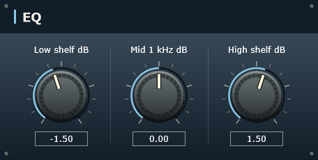

## Parametric EQ

Four fully adjustable bands. Sweep one band’s frequency to find a resonance, then use gain and Q to set the depth and width of the cut.

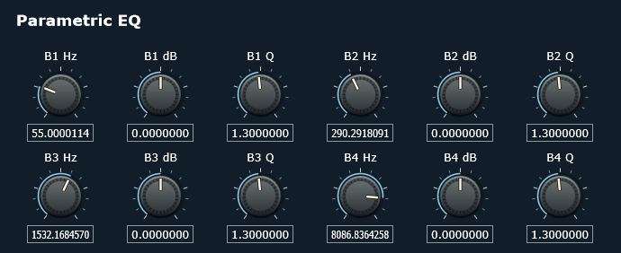

## 8-Band EQ

Eight independent frequency, gain and Q controls. Combine a narrow resonance cut on one band with a broad tonal lift on another.

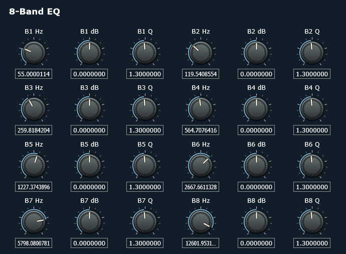

## Graphic EQ

Ten fixed-frequency faders show the overall EQ shape at a glance. Move one band at a time to identify the part of the sound it affects.

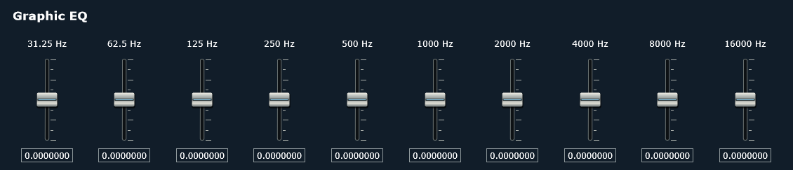

## Dynamic EQ

Reduces a band when its energy crosses the threshold. Set **Detector Hz** to the troublesome frequency, then use **Threshold** and **Maximum cut** to control the reduction.

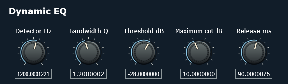

## Filter

Morph between low-pass, band-pass and high-pass responses. Sustain a sound and move **Low / band / high** and **Cutoff Hz** to hear the changing passband.

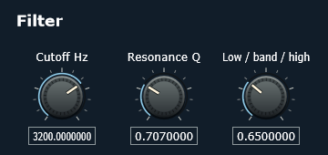

## High-Pass Filter

Passes highs and trims lows. Raise **Cutoff Hz** on a vocal or guitar until rumble recedes while the body of the performance remains.

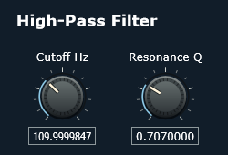

## Low-Pass Filter

Rolls off highs. Lower **Cutoff Hz** on a bright pad and adjust **Resonance Q** to emphasize the edge of the cutoff.

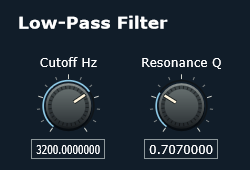

## Compressor

Evens out peaks on an individual part. Lower **Threshold dB**, then adjust **Ratio** and **Release ms** to control how firmly it reacts and recovers.

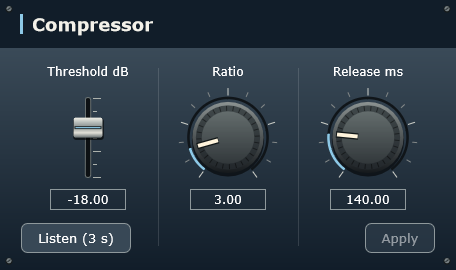

## Bus Compressor

Compresses a group of tracks together. Insert it on a drum bus, adjust **Attack ms** to retain the stick attack, then blend with **Wet %**.

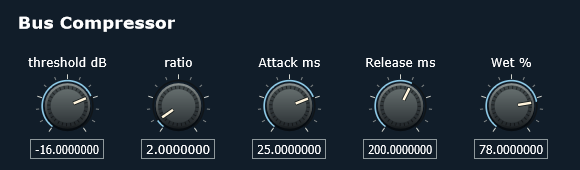

## Multiband Compressor

Splits the signal into three dynamic bands. Set **Low split Hz** and **High split Hz**, then adjust the low-band ratio when bass peaks need more control.

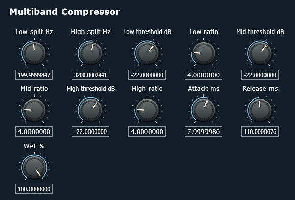

## Multiband Bus Compressor

Three-band bus compression with a wet blend. Lower the low-band threshold when kicks dominate a group, then use **Wet %** to bring the original transients back.

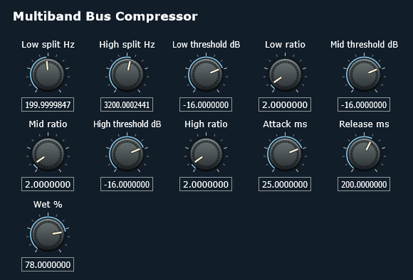

## Limiter

Sets an upper limit for peaks. Put it at the end of a chain, set **Ceiling dB**, then raise **Input gain dB** while observing the output.

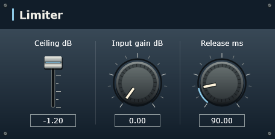

## Gate

Attenuates quiet passages between notes. Set **Open dB** for the wanted signal and lengthen **Release ms** to preserve syllable endings or drum tails.

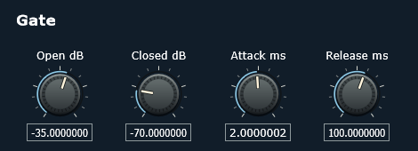

## De-Esser

Controls sharp sibilants in a vocal. Tune **Detector Hz** to the sound that sticks out and set **Maximum cut dB** so consonants stay intelligible.

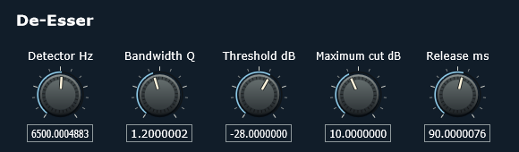

## Unmask

Makes room for a second track using a sidechain. Insert it on a guitar, send the vocal to its key input, then set **Max cut (dB)** for the space you want the vocal to occupy.

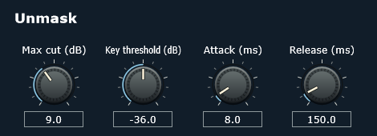

[Return to the plug-in guide](en.md)
