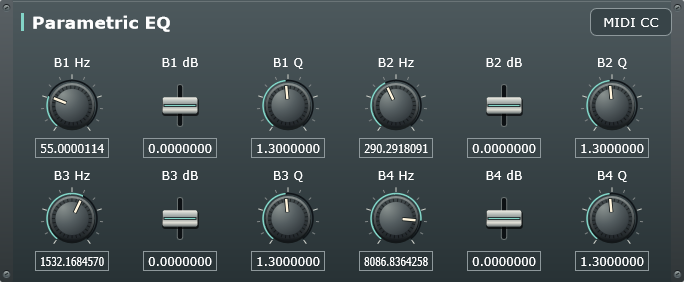
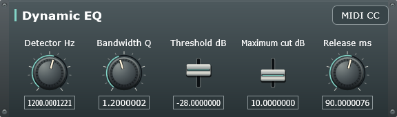
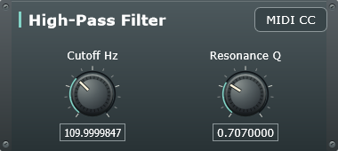
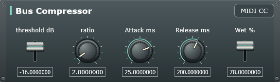
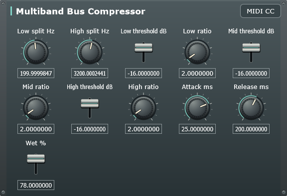
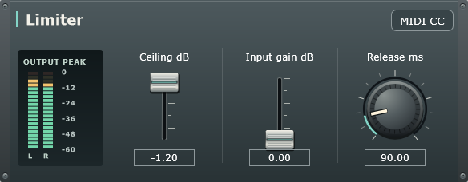
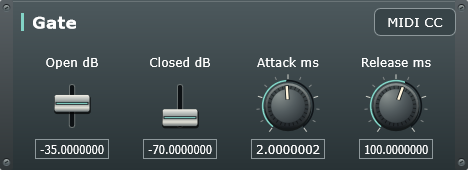
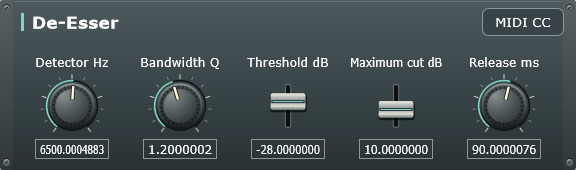

# EQ・フィルター・ダイナミクス

[English](eq-dynamics.en.md) · [図鑑の目次](README.md) · [Studio操作マニュアル](../manual/README.md)

周波数の偏り、音量差、他のトラックとの重なりを調整するときに使います。音を処理したいトラックかバスのFX枠に挿します。

[EQ](#eq) · [Parametric EQ](#parametric-eq) · [8-Band EQ](#8-band-eq) · [Graphic EQ](#graphic-eq) · [Dynamic EQ](#dynamic-eq) · [Filter](#filter) · [High-Pass Filter](#high-pass-filter) · [Low-Pass Filter](#low-pass-filter) · [Compressor](#compressor) · [Bus Compressor](#bus-compressor) · [Multiband Compressor](#multiband-compressor) · [Multiband Bus Compressor](#multiband-bus-compressor) · [Limiter](#limiter) · [Gate](#gate) · [De-Esser](#de-esser) · [Unmask](#unmask)

対応エフェクトの **MIDI CC** では、パラメーターを選んでコントローラーを動かすと、チャンネルとCC番号が登録されます。エフェクトにもMIDIが届くようにホストでルーティングしてください。割り当て済みの項目から再学習・解除ができ、設定はそのインスタンスに保存されます。

迷ったら、帯域の音量を整えるにはEQ、音量の山を抑えるにはCompressor、キックや歌のために別トラックの帯域を空けるにはUnmaskから試せます。

## EQ

Windows開発版では、低域・中域・高域のいずれかのフェーダーを動かすと、周波数ごとに設定したゲインがグラフに表示されます。隣のピークメーターは、実際に音を通したときの出力レベルを示します。

低域・1 kHz付近・高域を3つのノブで調整します。音色の輪郭を手早く変えたいときは、まず **Mid 1 kHz dB** を少し上下してみてください。

## Parametric EQ

4バンドそれぞれで周波数、ゲイン、帯域幅を設定できます。1つのバンドの **Hz** で気になる響きを探し、**dB** と **Q** で削る深さと幅を決めます。

## 8-Band EQ

ボーカルや楽器の複数の響きを個別に整えられる8バンドEQです。各バンドの **Hz・dB・Q** を独立して設定できるため、狭いカットと広いブーストを同時に使えます。

## Graphic EQ

周波数が固定された10本のフェーダーで音色を描くように調整します。低い帯域から1本ずつ動かすと、どの帯域が音の厚みや明るさを担うかを確認できます。

## Dynamic EQ

対象の帯域が強く鳴ったときだけ、その帯域を抑えます。**Detector Hz** で響きの中心を選び、**Threshold** と **Maximum cut** で働き始める音量と最大の削り幅を決めます。

## Filter

ローパス、バンドパス、ハイパスの間を連続的に動かせるフィルターです。音を伸ばしたまま **Low / band / high** と **Cutoff Hz** を動かすと、通過する帯域が変わります。

## High-Pass Filter

低域を取り除いて上の帯域を通します。ボーカルやギターの低い振動音を聴きながら **Cutoff Hz** を上げ、音の厚みが残る位置を探します。

## Low-Pass Filter

高域を落として音を暗くします。明るいパッドで **Cutoff Hz** を下げ、**Resonance Q** で境目の強調具合を変えてみてください。

## Compressor

大きい音を抑えて演奏の音量差を整えます。**Threshold dB** を下げて効き始める位置を探し、**Ratio** と **Release ms** で抑える量と戻り方を決めます。

## Bus Compressor

ドラムや楽器グループ全体の強弱をまとめます。バスに挿して **Attack ms** で打音の先端を残し、**Wet %** で原音と混ぜます。

## Multiband Compressor

低・中・高域の音量差を別々に抑えます。**Low split Hz** と **High split Hz** で境目を決め、たとえば低音だけに強めの圧縮をかけられます。

## Multiband Bus Compressor

バス全体の強弱を3帯域で整え、処理音を原音に混ぜます。キックで低域が膨らむときは低域のしきい値を調整し、**Wet %** で効きを加減します。

## Limiter

ピークの上限を決めるエフェクトです。チェーンの最後で **Ceiling dB** を決め、**Input gain dB** を上げながらピークの変化を確認します。

## Gate

休符やフレーズの隙間の小さい音を下げます。**Open dB** で開くしきい値を決め、**Release ms** を延ばして語尾やドラムの余韻を残します。

## De-Esser

ボーカルのサ行など、突出する高域を抑えます。**Detector Hz** を発音に合わせ、**Maximum cut dB** で子音を残せる深さにします。

## Unmask

別のトラックが鳴る間、重なる帯域を伴奏側で下げます。たとえばギターに挿し、歌をサイドチェーンに送ると、**Max cut (dB)** で声のために空ける量を調整できます。

[プラグイン図鑑の目次に戻る](README.md)
