# Space, modulation, guitars and racks

[日本語](space-and-tone.md) · [All plug-ins](en.md) · [Studio user manual](../manual/en.md)

Add space, echoes, movement or drive. This group also includes instrument-specific rigs and a rack for parallel effect chains.

[Reverb](#reverb) · [Delay](#delay) · [Chorus](#chorus) · [Phaser](#phaser) · [Flanger](#flanger) · [Harmonizer](#harmonizer) · [Distortion](#distortion) · [Guitar Amp](#guitar-amp) · [Electric Guitar Rig](#electric-guitar-rig) · [Acoustic Guitar Rig](#acoustic-guitar-rig) · [Bass Rig](#bass-rig) · [Effect Rack](#effect-rack) · [SUPER KNOBBER REVERB](#super-knobber-reverb)

## Reverb

Adds room reflections and a reverb tail. On a return, set **Wet %** to 100 and control the amount from the track send. Change **Room size %** to vary the space.

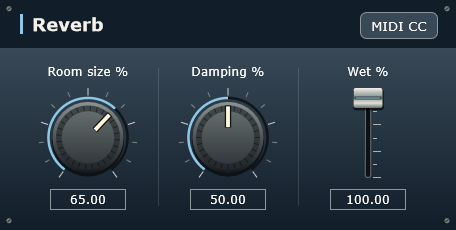

## Delay

Repeats the signal as an echo. Set **Delay ms** for the space between repeats, then use **Feedback %** to control how long a phrase trails away.

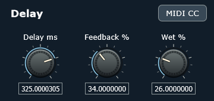

## Chorus

Thickens keys or guitar with modulated, delayed copies. Set **Rate Hz** for the movement and **Wet %** for how much of it you hear.

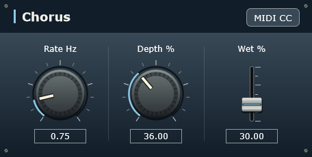

## Phaser

Creates sweeping notches in the spectrum. Hold a chord, slow **Rate Hz**, then raise **Depth %** to bring the sweep forward.

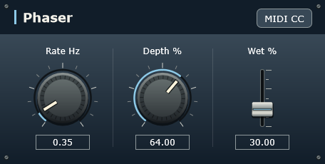

## Flanger

Uses a short modulated delay for a metallic sweep. Raise **Depth %** on a drum fill, then balance it against the original with **Wet %**.

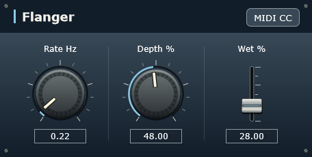

## Harmonizer

Adds two pitch-shifted voices. Set **Voice A (st)** to +7 and **Voice B (st)** to +12 to hear a fifth and an octave above the input.

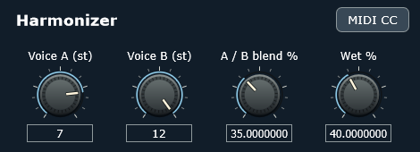

## Distortion

Adds harmonics by driving the input. Set **Drive dB**, shape the brightness with **Tone Hz**, then blend in the original signal using **Wet %**.

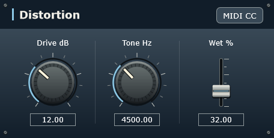

## Guitar Amp

Adds preamp drive and cabinet coloration to a direct guitar. Set **Preamp dB** for the amount of drive and **Cabinet tone Hz** for the high end.

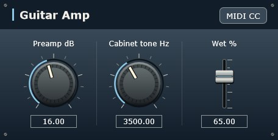

## Electric Guitar Rig

Set **Threshold** on the compressor pedal, then balance **Drive** and **Amp mix** on the amp. Alternate light and heavy picking to hear the difference.

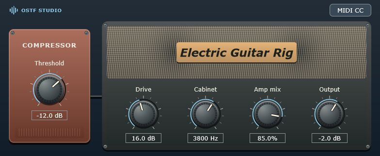

## Acoustic Guitar Rig

Use **Notch** on the green EQ pedal to find a resonant body frequency and **Depth** to reduce it. Adjust **Air** and **Room** on the cabinet to finish the sound.

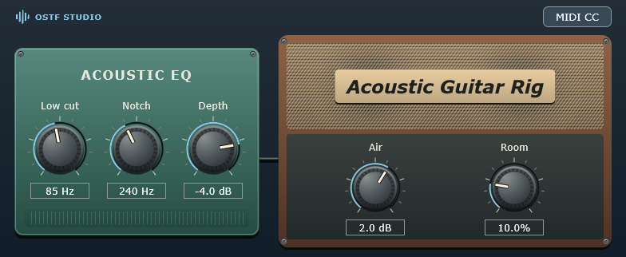

## Bass Rig

Use **Threshold** on the compressor pedal to control accented notes. On the metal-grille amp, adjust **Drive** and **Amp blend** to add harmonics while retaining the bass foundation.

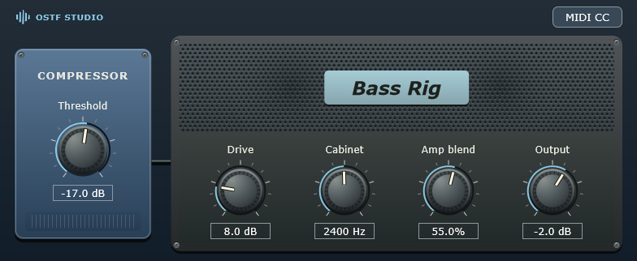

## Effect Rack

Sends the same audio into parallel effect chains. Add a chain with **+ Effect layer**, then use **Layer level** to balance, for example, a short reverb against a longer echo.

## SUPER KNOBBER REVERB

Choose a space, source profile and style. Dry / Wet, Decay, Pre Delay and Output stay visible above the detail pages. On a return, use 100% wet. The IN, WET and OUT meters show the peaks of the input, the reverb contribution after mixing, and the combined output.

Use the analyzer to compare input with wet, hear and see the effect of input filtering or post EQ, inspect the five decay targets, or follow a tail in the wet history and stereo waveform. Changing pre-delay blends the two delay positions over 20 ms.

For a tail comparison, play a short hit and stop the input. Select the wet RMS and stereo correlation display. RMS follows the average wet level. Correlation shows how similar the left and right tails are. The five RT60 values are the decay targets for each band.

[Signal path and controls](super-knobber-reverb.en.md)

[Return to the plug-in guide](en.md)
