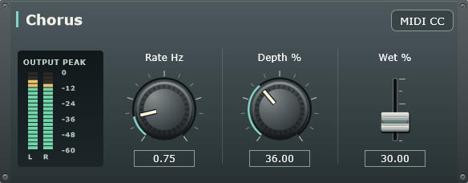
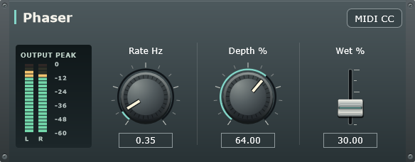
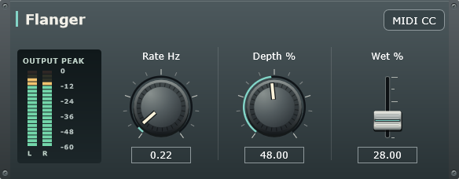
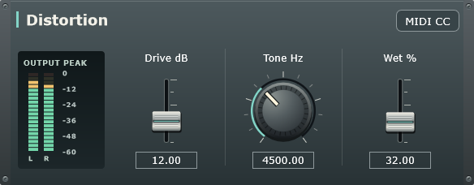
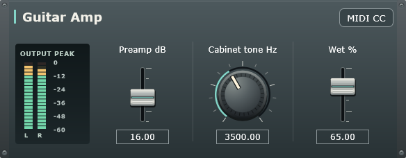
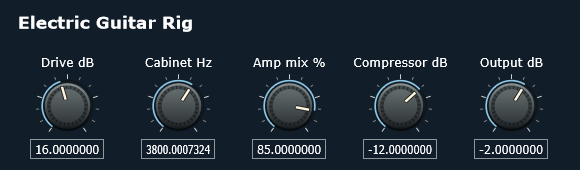
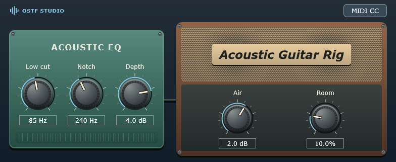
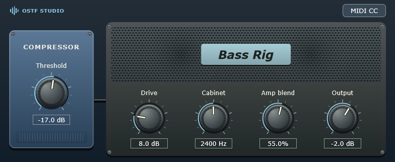
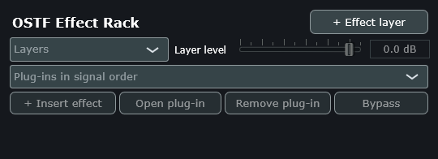

# 空間・モジュレーション・ギター・ラック

[English](space-and-tone.en.md) · [図鑑の目次](README.md) · [Studio操作マニュアル](../manual/README.md)

残響、反復、揺れ、歪みを加えます。ギター用の処理や、複数のエフェクトを重ねるラックもここにあります。

[Reverb](#reverb) · [Delay](#delay) · [Chorus](#chorus) · [Phaser](#phaser) · [Flanger](#flanger) · [Harmonizer](#harmonizer) · [Distortion](#distortion) · [Guitar Amp](#guitar-amp) · [Electric Guitar Rig](#electric-guitar-rig) · [Acoustic Guitar Rig](#acoustic-guitar-rig) · [Bass Rig](#bass-rig) · [Effect Rack](#effect-rack) · [SUPER KNOBBER REVERB](#super-knobber-reverb)

Windows開発版のReverb、Delay、Chorus、Phaser、Flangerでは、フレーズを再生しながら **Wet %** フェーダーで原音と処理音のバランスを調整できます。左右のメーターはエフェクト出力のピークです。[トラックのFXチェーンを並べ替える](../manual/README.md#fx-rack)

## Reverb

音に部屋の響きを加えます。リターンで使うときは **Wet %** を100にし、各トラックのセンドで残響量を調整します。**Room size %** で空間の大きさが変わります。

## Delay

一定の間隔で音を繰り返します。歌の語尾を伸ばすようなエコーにするには、**Delay ms** で間隔を、**Feedback %** で繰り返しの残り方を調整します。

## Chorus

わずかに時間の異なる音を重ね、鍵盤やギターの音を厚くします。**Rate Hz** で揺れの速さを、**Wet %** で原音に混ぜる量を決めます。

## Phaser

音色の中に周期的に動くくぼみを作ります。コードを伸ばし、**Rate Hz** を遅くして **Depth %** を上げると、うねりを聴き取りやすくなります。

## Flanger

短い遅延を揺らし、金属的なジェット音に似た響きを作ります。ドラムのフィルで **Depth %** を上げ、**Wet %** で原音の輪郭を戻せます。

## Harmonizer

原音に最大2声の移調音を重ねます。**Voice A (st)** を+7、**Voice B (st)** を+12にすると、完全5度とオクターブ上を同時に試せます。

## Distortion

入力を歪ませて倍音を加えます。**Drive dB** で歪みの量を決め、**Tone Hz** で明るさを調整して、**Wet %** で原音に混ぜます。

## Guitar Amp

ギターのライン音にアンプの歪みとキャビネットの音色を加えます。**Preamp dB** で押し込み具合を変え、**Cabinet tone Hz** で高音を整えます。

## Electric Guitar Rig

左のコンパクトペダルで **Threshold** を調整し、右のアンプで **Drive** と **Amp mix** を合わせます。弱く弾いた音と強く弾いた音を交互に試してみてください。

## Acoustic Guitar Rig

緑のEQペダルで **Notch** を動かして胴鳴りの周波数を探し、**Depth** で抑えます。右側の **Air** と **Room** で高域と部屋の響きを整えます。

## Bass Rig

左のコンプレッサーの **Threshold** で強く弾いた音を整えます。金属グリルのアンプで **Drive** と **Amp blend** を調整すると、低域の芯を保ちながら倍音を足せます。

## Effect Rack

同じ音を複数のエフェクト列に送り、並列で混ぜます。**+ Effect layer** で列を増やし、たとえば短い残響と長いエコーの音量を **Layer level** で個別に調整できます。

## SUPER KNOBBER REVERB

空間のタイプ、入力素材、スタイルを選びます。Dry / Wet、Decay、Pre Delay、Output はどの詳細ページでも操作できます。リターンでは通常 Dry / Wet を100％にします。IN は入力、WET は実際にミックスに加わる残響、OUT は合成後の出力のピークです。

アナライザーで入力と残響のスペクトル、入力フィルターやポストEQの前後、5帯域の減衰設定を確認できます。Wet waveform / tail は直近5秒の残響の波形を表示します。Pre Delay を動かすと、前後のディレイ位置を20ミリ秒かけて切り替えます。

尾を聴き比べるには、短い音を鳴らしてから入力を止め、アナライザーを **Wet RMS** とステレオ相関の表示に切り替えます。RMSは残響の平均レベル、相関は残響の左右の似かより具合です。5帯域のRT60は各帯域に設定した減衰時間の目安です。

[詳しい操作と入出力](super-knobber-reverb.md)

[プラグイン図鑑の目次に戻る](README.md)
