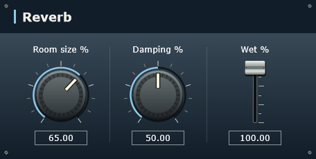
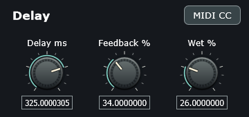
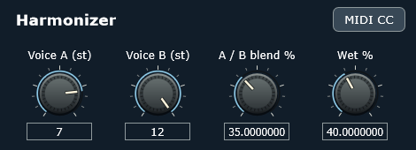

# 空間・モジュレーション・ギター・ラック

[English](space-and-tone.en.md) · [図鑑の目次](README.md) · [Studio操作マニュアル](../manual/README.md)

残響、反復、揺れ、歪みを加えます。ギター用の処理や、複数のエフェクトを重ねるラックもここにあります。

[Reverb](#reverb) · [Delay](#delay) · [Chorus](#chorus) · [Phaser](#phaser) · [Flanger](#flanger) · [Harmonizer](#harmonizer) · [Distortion](#distortion) · [Guitar Amp](#guitar-amp) · [Electric Guitar Rig](#electric-guitar-rig) · [Acoustic Guitar Rig](#acoustic-guitar-rig) · [Bass Rig](#bass-rig) · [Effect Rack](#effect-rack)

## Reverb

音に部屋の響きを加えます。リターンで使うときは **Wet %** を100にし、各トラックのセンドで残響量を調整します。**Room size %** で空間の大きさが変わります。

## Delay

一定の間隔で音を繰り返します。歌の語尾を伸ばすようなエコーにするには、**Delay ms** で間隔を、**Feedback %** で繰り返しの残り方を調整します。

## Chorus

わずかに時間の異なる音を重ね、鍵盤やギターの音を厚くします。**Rate Hz** で揺れの速さを、**Wet %** で原音に混ぜる量を決めます。

## Phaser

音色の中に周期的に動くくぼみを作ります。コードを伸ばし、**Rate Hz** を遅くして **Depth %** を上げると、うねりを聴き取りやすくなります。

## Flanger

短い遅延を揺らし、金属的なジェット音に似た響きを作ります。ドラムのフィルで **Depth %** を上げ、**Wet %** で原音の輪郭を戻せます。

## Harmonizer

原音に最大2声の移調音を重ねます。**Voice A (st)** を+7、**Voice B (st)** を+12にすると、完全5度とオクターブ上を同時に試せます。

## Distortion

入力を歪ませて倍音を加えます。**Drive dB** で歪みの量を決め、**Tone Hz** で明るさを調整して、**Wet %** で原音に混ぜます。

## Guitar Amp

ギターのライン音にアンプの歪みとキャビネットの音色を加えます。**Preamp dB** で押し込み具合を変え、**Cabinet tone Hz** で高音を整えます。

## Electric Guitar Rig

エレキギターの駆動、キャビネット、圧縮、出力を1つの画面で調整します。**Drive dB** と **Amp mix %** から始め、ピッキングの強弱を弾き比べてください。

## Acoustic Guitar Rig

アコースティックギターの低い振動や胴鳴りを整えます。**Notch Hz** で響きすぎる周波数を探し、**Notch cut dB** で下げ、必要に応じて **Room %** で空間を足します。

## Bass Rig

低域の芯を残しながらアンプの倍音を足せます。**Amp blend %** で原音との比率を決め、**Compressor dB** で強く弾いた音の飛び出しを整えます。

## Effect Rack

同じ音を複数のエフェクト列に送り、並列で混ぜます。**+ Effect layer** で列を増やし、たとえば短い残響と長いエコーの音量を **Layer level** で個別に調整できます。

## SUPER KNOBBER REVERB

StudioやほかのVST3ホストで、トラックまたはリターンに挿します。上段で空間のタイプ、入力素材、スタイルを選びます。**Space & reflections → Pre Delay** を上げると、原音の立ち上がりと初期反射の間が空きます。トラックに挿したときは **Output → Dry / Wet** で原音とのバランスを調整できます。リターンでは通常100％にします。

上部のアナライザーで、入力と残響のスペクトル、ポストEQの前後、5帯域の残響時間設定、残響レベルの推移を確認できます。

[プラグイン図鑑の目次に戻る](README.md)
