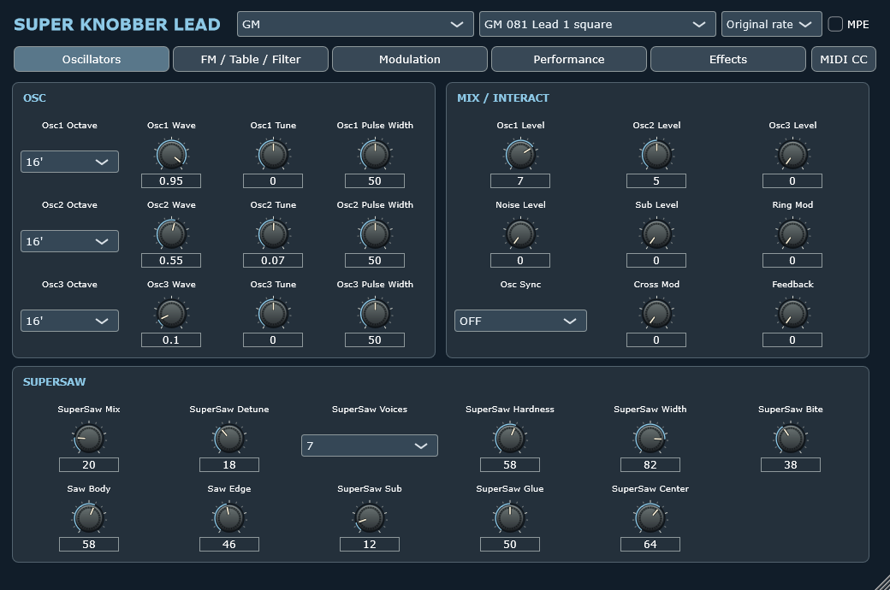

# SUPER KNOBBER LEAD

[日本語](super-knobber-lead.md) · [All plug-ins](en.md)

**Signal path.** This MIDI instrument returns a stereo lead sound. Put it in a Studio instrument slot or on an instrument track in your DAW.

| Control | What to listen for |
| --- | --- |
| Genre and preset | Start with one of the 188 sounds, for example a GM lead. |
| Oscillators and source mixer | Set the wave, tuning and source levels. Bring in each source while holding a note to hear what it contributes. |
| FM / Table / Filter | Sustain a note and move Cutoff to shape brightness. |
| AMP ENV and Portamento | Set the attack of short notes and the glide between successive pitches. |
| Original rate / 2x oversampling | Compare a bright, driven phrase in both modes. Both report 16 samples of latency to the host. |

Use DAW automation or **MIDI CC** learn to move the exposed sound parameters. [Complete control ranges and defaults](../../src/plugins/instruments/knobber/Controls.h)
