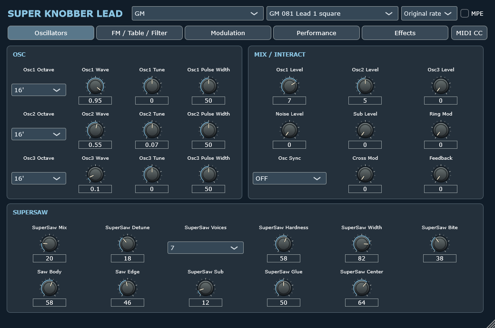

# SUPER KNOBBER LEAD

[English](super-knobber-lead.en.md) · [図鑑の目次](README.md)

**用途と入出力**　MIDIノートを受けてステレオで出力するリードシンセです。Studioでは音源枠、外部DAWではインストゥルメントトラックに挿します。

| 操作 | 聴きどころ |
| --- | --- |
| ジャンルとプリセット | GMのリードなど、188音色から演奏の出発点を選びます。 |
| オシレーターとミキサー | 波形・ピッチと各音源の量を決めます。少しずつ足すと、どの成分が音を太くしたか分かります。 |
| FM / Table / Filter | 長いノートを押しながらCutoffを動かし、アタックと明るさを調整します。 |
| AMP ENV・Portamento | 短い音の立ち上がりと、連続する音の間の滑り方を設定します。 |
| Original rate / 2x oversampling | 歪ませた高音を同じフレーズで比較できます。どちらもホストへ16サンプルの遅延を報告します。 |

対応パラメーターはDAWのオートメーション、または **MIDI CC** の学習で動かせます。[全コントロールの範囲と初期値](../../src/plugins/instruments/knobber/Controls.h)
