# Composition and instruments

[日本語](workstations.md) · [All plug-ins](en.md) · [Studio user manual](../manual/en.md)

Load the workstation or a playable instrument in your DAW’s instrument slot. To edit the notes of a Studio project in the development build, open an OSTF Tool from a compatible track’s wrench inside Studio.

[OSTF Studio](#ostf-studio) · [OSTF Scale Editor](#ostf-scale-editor) · [OSTF Velocity Shaper](#ostf-velocity-shaper) · [OSTF Guitar Voicer](#ostf-guitar-voicer) · [OSTF Motif Expander](#ostf-motif-expander) · [OSTF Note Split](#ostf-note-split) · [GM Sound Module](#gm-sound-module) · [OSTF Formant Singer](#ostf-formant-singer) · [FM Synth](#fm-synth) · [Analog Synth](#analog-synth) · [Wavetable Synth](#wavetable-synth) · [Drum Machine](#drum-machine) · [Instrument Rack](#instrument-rack) · [SUPER KNOBBER LEAD](#super-knobber-lead) · [SUPER KNOBBER PAD](#super-knobber-pad) · [SUPER KNOBBER PIANO](#super-knobber-piano) · [OSTF Chord Trigger](#ostf-chord-trigger) · [OSTF Rhythm Generator](#ostf-rhythm-generator) · [OSTF Quantize](#ostf-quantize) · [SUPER KNOBBER ORGAN](#super-knobber-organ) · [OSTF Arpeggiator](#ostf-arpeggiator) · [OSTF Velocity Range](#ostf-velocity-range) · [OSTF Legato](#ostf-legato)

## OSTF Studio

The complete workstation on a stereo instrument track. Choose **OSTF Studio (VST3)** in the Public Alpha 2 installer, open Paper Lantern Replies inside the plug-in, and start your host transport to hear the arrangement.

[Signal path and controls](ostf-studio.en.md)

## OSTF Scale Editor

The development build also accepts Scale Editor in the global wrench beside the prompt arrows and the voicing and audio track wrenches. These slots show compatible tools.

In the development build, choose **Tools → OSTF Scale Editor** on the MIDI track whose instrument you want to hear. Older projects that used Scale Editor in the instrument slot retain their saved audition instrument.

In Public Alpha 2, load **OSTF Scale Editor** on an instrument track **inside OSTF Studio**. In another DAW, load **OSTF Studio (VST3)** first and open the project there. Choose a chord in the left pane, audition candidates, then choose **Set scale**. The check mark and scale name show the assignment for the selected target. **Harmony** updates Studio’s global scale lane. A pitched track receives its own scale direction. Save the project in Studio or in the DAW containing it.

Select the section in the header and click **Play section**, or choose **Play song** to start at the beginning. The header names the sounding scale. In Public Alpha 2 the header also lets you choose the audition instrument. [Assign and audition scales](../manual/en.md#scale-assignment)

## OSTF Velocity Shaper

**Windows development preview**

Select **Sections**, the section and its take. In **Dynamics**, set **Overall level** to balance the section against the rest of the song. Shape **Entry** and **Ending** to build or relax inside the section. The graph shows one bar per note, with a line for its original velocity. Click **Listen A / B**, then **Apply**.

Click a bar number on the ruler to adjust that measure’s pulse. Use **Chords** when the gesture follows a harmony change halfway through the bar. The levels add together. Revising the section later preserves an applied bar or chord adjustment. Double-click the graph to return to the parent target.

**Prompt guide** inserts an editable instruction such as “Keep the verse quieter than the chorus and build towards its ending.” **AI proposal** uses the selected target, take, section levels, meter and chord context to fill the four controls. Audition the proposal before applying it.

In the development build, click **Sections** to see the named section tabs. Choose a section, take and shape to compare the original velocities with the proposed bars. **Beat controls** exposes one vertical fader per rhythmic position.

Open the tool on a MIDI track, then choose a section, take and shape. Gentle, Beat accents and Lift apply offsets to the played velocities. Choose an immediate switch or a blend over 1, 2 or 4 beats. Apply sections in song order to blend from the preceding adopted take's shape. An unconfigured predecessor uses the original dynamics. Reapplying the same shape preserves the previously calculated velocities.

After editing sections out of order, choose **All configured section transitions** in the target list to recompute just the entrances of adopted takes in one edit.

Click **Preview edits** to inspect the count, then **Listen A** or **Listen B** through the track's local instrument. **Apply** writes the target. **To new take** copies a supported whole section in OSTF 5.1 or 5.2 and writes the result there. The original stays adopted until you choose a different take in Studio.

Choose **Piano roll · selected notes**, one **Chord** by bar and beat, a section, a take range or **Entire MIDI track**. The take selector shows the available performances for that range. A whole track spanning multiple comp regions uses the adopted performance. Choose one take range to edit an alternate. Piano-roll selection uses the notes in the displayed take.

In **Beat controls**, adjust downbeats, offbeats, contrast or limits. **Velocity offset** adds a fixed amount to the current values. The graph updates before you apply. Each grey mark shows the played velocity and each green bar shows the proposed velocity, at its position on the bar ruler. Notes struck together appear side by side. Hover for exact values. Click or drag across the graph to restrict the edit to individual notes, or double-click to include the whole target again. **Apply** writes the previewed changes in one Studio Undo step.

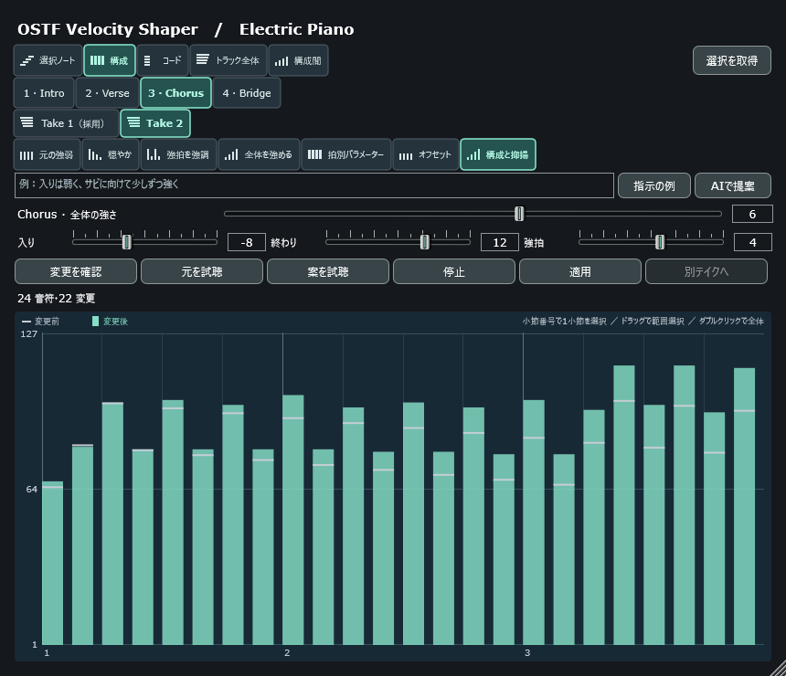

## OSTF Guitar Voicer

**Windows development preview**

After creating a take, find its lane below the source track over the same section. The highlight marks the adopted performance. Click the lane to open the take menu.

Open **Tools → OSTF Guitar Voicer** on a pitched MIDI track. Select a section and take, set a fret range and preview. The fretboard shows the first voicing, from low E at the bottom to high E at the top. **Link positions** also considers the preceding chord when choosing a fingering. The target can be changed to the current piano-roll note selection.

The tool voices groups of 3–6 simultaneous notes from the same clip containing at least three pitch classes. Each string receives one chord tone in standard tuning. Existing gates and velocities are retained, and additional voices inherit those of the upper source note. Single notes, arpeggios and unplayable groups are counted as skipped. Audition and apply use the same section controls as Velocity Shaper.

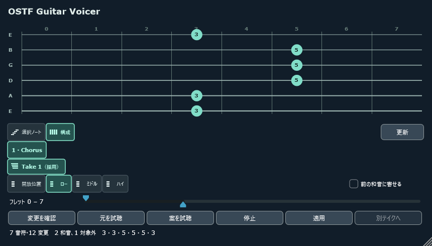

Click a section tab to see its first fingering. Try Open, Low, Middle or High, or drag both ends of the range to choose exact frets.

## OSTF Motif Expander

**Windows development preview**

You can capture and audition a vocal melody with linked lyrics. Place the variation as MIDI in a gap. Linked vocal clips require an authored take map to fork their lyrics.

Open the wrench on a pitched MIDI track, add **OSTF Motif Expander**, select 1–96 piano-roll notes in one take and click **Capture selection**. The header identifies the source track, take and bar. Choose a variation style and similarity, then click **Generate**. The two lanes share a time axis and pitch range. Use **Hear source** and **Hear variation** to compare them. **AI variation** sends the captured notes and settings to the AI connected to Studio. Manage that connection from the top of any tool window.

- **New take here** copies the source clips or existing comp range in an OSTF 5.1 or 5.2 score. It changes the selected notes in the copy and preserves the adopted performance. Linked vocal notes and clips requiring dedicated performance maps can restrict take creation.
- **Place at cursor** writes the variation into the selected MIDI track and editing take. Inside a comp group, the entire phrase must fit in an empty range of the chosen take’s output clip. Both placement operations have a single undo step.

## OSTF Note Split

**Windows development preview**

Choose **Tools → OSTF Note Split** on a MIDI track. Select notes in its piano roll. A bright outline and check mark identify the selection. Each note is divided within its original duration, including when several notes overlap.

Use **Even** for a fixed count per note. **Bar gradient** cycles between two densities over a given number of bars. **Continuous** varies density over each note, with optional beat or bar alignment. The preview shows up to six source notes. Each bar's width shows its gate and its height shows velocity. **Split selection** applies to every selected note. If chance drops all strokes for a source note, Studio keeps the original. One Studio Undo restores the selection's original performance.

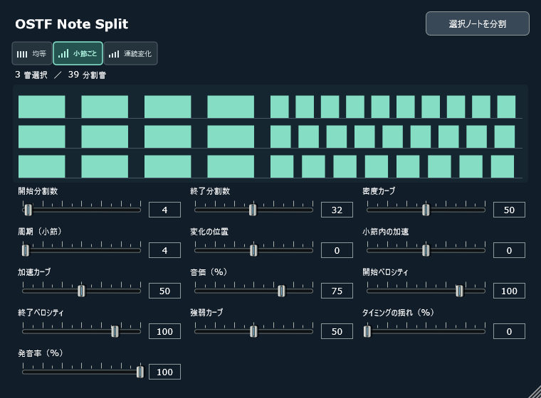

## GM Sound Module

A 16-part General MIDI instrument. Send piano and bass to different MIDI channels, choose a sound for each part and watch the corresponding channel meters.

## OSTF Formant Singer

Sings the notes and lyrics of an OSTF vocal part. In an external host, use **Load OSTF**, select the vocal part and play the song. Compare **Vibrato / scoop depth** on a sustained note.

For a short phrase, try a vocal part with the English word as its display lyric and matching katakana aligned to its notes. The chorus in **Paper Lantern Replies** is an example for comparing joined consonants and sustained vowels.

## FM Synth

Choose a patch to change the modulation ratio, then turn **Tone**. The display overlays the modulator with the resulting waveform at note onset.

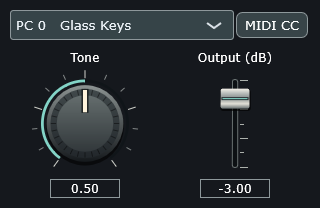

## Analog Synth

Turn **Tone** while playing a bass line. The amber curve shows how the low-pass response at note onset shifts toward higher frequencies.

## Wavetable Synth

Turn **Tone** to move the highlighted reference waveform through the table. Compare the movement of **Air Pad** with **Digital Stab**.

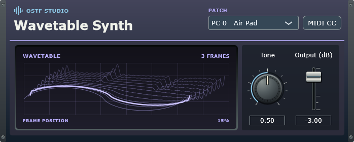

## Drum Machine

In the Windows development build, click any of the twelve pads to audition its voice. The pad also lights when its MIDI note arrives. Choose a kit in the header and use the output fader to match levels.

A drum instrument that maps MIDI notes to percussion voices. Play the same beat with **Studio Kit** and **Tight Machine** to compare the length and tone of the hits.

## Instrument Rack

Layer instruments on one MIDI part. Add two devices with **+ Instrument layer**, then use each **Layer level** to blend a quiet pad under a piano.

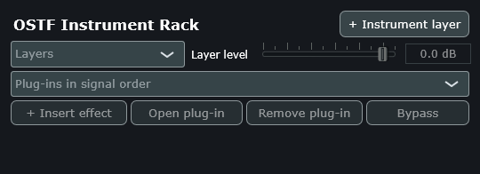

## SUPER KNOBBER LEAD

Play the LEAD v1.2 instrument on a MIDI track in Studio or another VST3 host. Choose a genre and preset at the top. Try **GM → GM 082 Lead 2 sawtooth**, then open **FM / Table / Filter** and turn **Cutoff** to hear the change in brightness. The host can automate each sound control directly.

**Original rate** is the default. Try **2x oversampling** on a bright, driven lead and listen to the upper notes. Both modes report 16 samples of latency.

[Signal path and controls](super-knobber-lead.en.md)

## SUPER KNOBBER PAD

**Windows development preview**

Choose **GM → GM 093 Pad 5 bowed** and sustain a chord. On the Oscillators page, String Mix blends the bowed layer, Bow Noise adds bow texture and Ensemble changes its stereo motion. The bank contains 188 factory programs from the PAD v1.0 device.

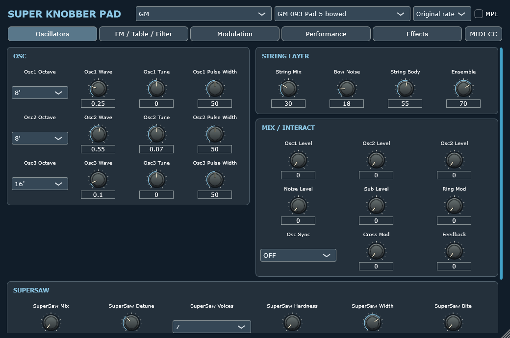

[Return to the plug-in guide](en.md)

## SUPER KNOBBER PIANO

**Windows development preview**

Choose **GM → GM 001 Acoustic Grand Piano**. Play a three-note chord, hold the sustain pedal and release the keys. **Damper**, **Sympathetic** and **Pedal Resonance** shape the tail. Compare **GM 005 Electric Piano 1** for a different attack. The instrument ports 119 programs across 38 banks from PIANO v1.5. It shares LEAD’s quality selector, MIDI CC learn and effects layout.

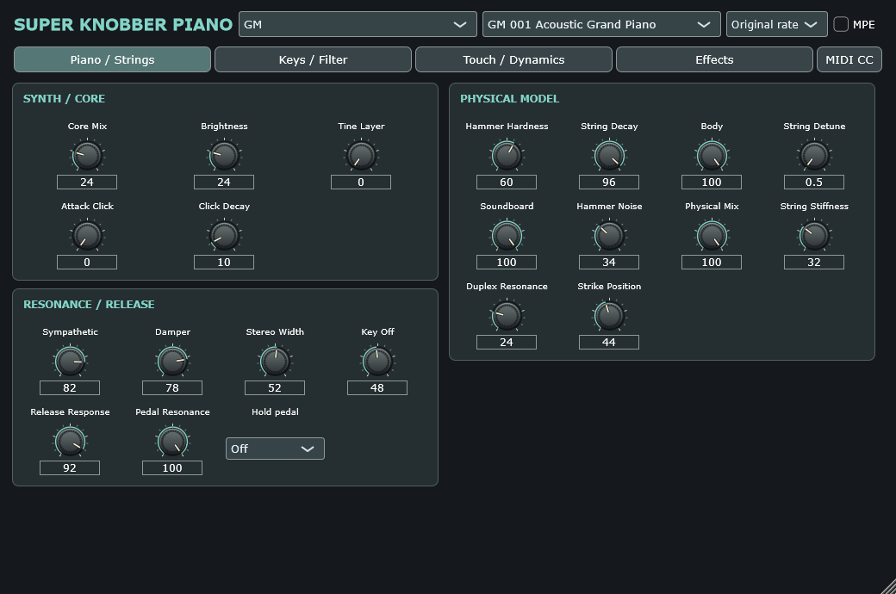

## OSTF Chord Trigger

**Windows development preview**

Select the root notes in the piano roll, open Chord Trigger from the track wrench and choose Major, Minor, Sus2, Sus4, 7, Maj7, m7, Dim or Aug. Set an inversion, check the additional pitches, then press **Apply**. The roots retain their timing and velocity. Existing pitches at the same onset are skipped.

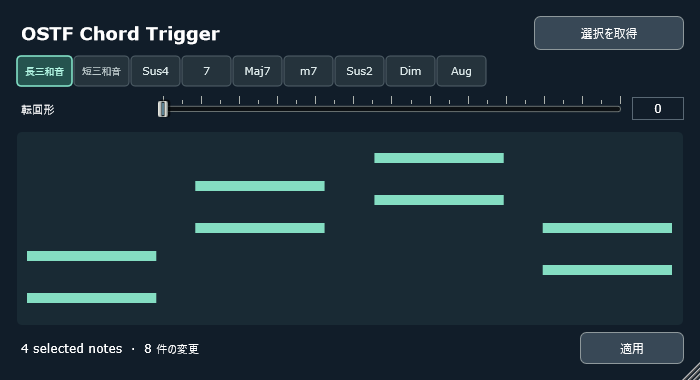

## OSTF Rhythm Generator

**Windows development preview**

Place the edit cursor in a complete bar on a MIDI or drum track. Choose the step count, hits per bar and MIDI pitch or kit sound. The tool spreads the hits across the actual meter and accents the first hit. Press **Read cursor bar** after moving the cursor. **Apply** writes the pattern to the editing take. An empty selection is valid. Use Rotate to shift the hits and first accent around the bar while retaining the pulse count.

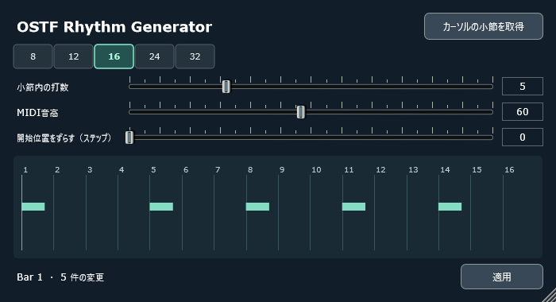

## OSTF Quantize

**Windows development preview**

Select pitched or drum notes and choose a straight or triplet grid. **Strength** sets how far the attacks move. **Swing** delays every other grid point. The amber marks show original attacks and the green notes show the proposed positions. Press **Apply** to keep the new timing. Durations and velocities are retained.

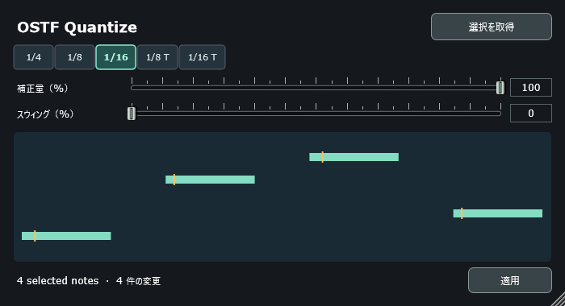

## SUPER KNOBBER ORGAN

**Windows development preview**

Select **GM / Core → GM 017 Drawbar Organ**. Pull the 16-foot and 8-foot drawbars toward you to bring out the lower harmonics, then raise Rotary Mix and change Rotary Speed while holding a chord. Compare the rock, church and reed programs. The v1.0 factory bank contains 242 programs in 40 categories. The three-voice instrument shares LEAD’s effects, MIDI CC Learn and 2× quality switch.

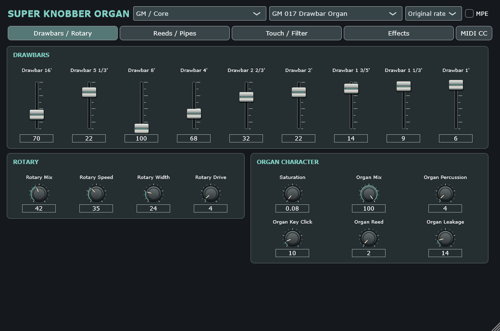

## OSTF Arpeggiator

**Windows development preview**

Select simultaneous notes in one clip. Choose Up, Down or Up / Down, set the number of steps per quarter and the gate, then press Apply. The pattern repeats until the shortest selected note ends. Chords too short for one pass and chords with lyrics are skipped.

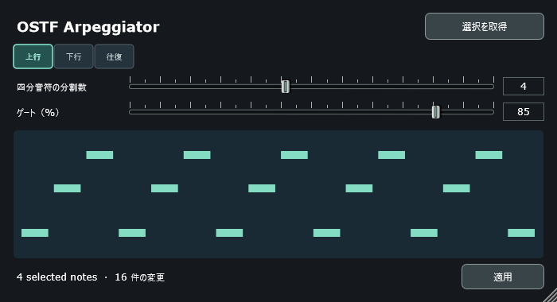

## OSTF Velocity Range

**Windows development preview** · Select notes in the piano roll and open this tool from the track wrench. Read the selection, set the floor and ceiling, and check how many notes will change. Quiet notes rise to the floor, loud notes fall to the ceiling, and notes in between keep their original dynamics. Both limits can meet at one fixed velocity. Notes with inherited velocity keep that inheritance.

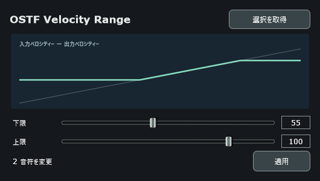

## OSTF Legato

**Windows development preview**

Select a phrase, choose 100%, 90% or 75%, then set the largest interval to connect in quarter notes. The last selected onset in each clip keeps its release. For a quick 100% connection with a four-quarter limit, press Legato in the piano-roll inspector.

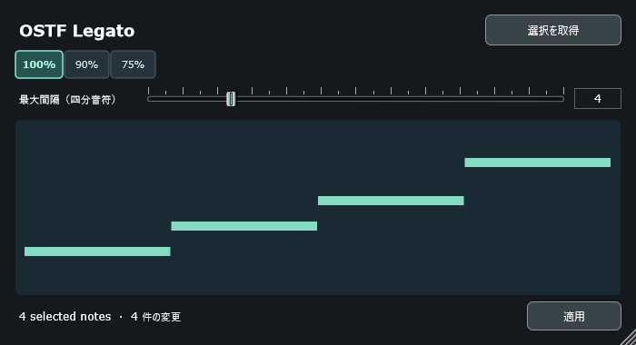
