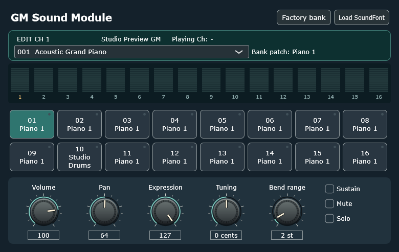
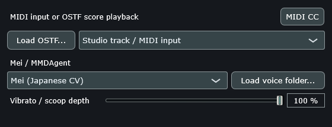

# Composition and instruments

[日本語](workstations.md) · [All plug-ins](en.md) · [Studio user manual](../manual/en.md)

Load these on an instrument track to play a score, sing lyrics or turn live MIDI into sound.

[OSTF Studio](#ostf-studio) · [OSTF Scale Editor](#ostf-scale-editor) · [GM Sound Module](#gm-sound-module) · [OSTF Formant Singer](#ostf-formant-singer) · [FM Synth](#fm-synth) · [Analog Synth](#analog-synth) · [Wavetable Synth](#wavetable-synth) · [Drum Machine](#drum-machine) · [Instrument Rack](#instrument-rack)

## OSTF Studio

The complete workstation on a stereo instrument track. Choose **OSTF Studio (VST3)** in the development installer, open Paper Lantern Replies inside the plug-in, and start your host transport to hear the arrangement.

## OSTF Scale Editor

In the development build, load **OSTF Scale Editor** on an instrument track **inside OSTF Studio**. In another DAW, load **OSTF Studio (VST3)** first and open the project there. Choose a chord in the left pane, audition candidates, then choose **Set scale**. The check mark and scale name show the assignment for the selected target. **Harmony** updates Studio’s global scale lane. A pitched track receives its own scale direction. Save the project in Studio or in the DAW containing it.

## GM Sound Module

A 16-part General MIDI instrument. Send piano and bass to different MIDI channels, choose a sound for each part and watch the corresponding channel meters.

## OSTF Formant Singer

Sings the notes and lyrics of an OSTF vocal part. In an external host, use **Load OSTF**, select the vocal part and play the song. Compare **Vibrato / scoop depth** on a sustained note.

## FM Synth

An FM instrument for electric keys, bells and plucks. Hold the same chord with **Glass Keys** and **Bell Cascade** to hear how their attacks and decays differ.

## Analog Synth

An analog-style instrument for bass, saw leads and brass. Play a low line with **Round Bass**, then switch to **Twin Saw** to compare their harmonic character.

## Wavetable Synth

A wavetable instrument for moving pads and short stabs. Hold a chord with **Air Pad** while changing **Tone**, then play it staccato with **Digital Stab**.

## Drum Machine

A drum instrument that maps MIDI notes to percussion voices. Play the same beat with **Studio Kit** and **Tight Machine** to compare the length and tone of the hits.

## Instrument Rack

Layer instruments on one MIDI part. Add two devices with **+ Instrument layer**, then use each **Layer level** to blend a quiet pad under a piano.

[Return to the plug-in guide](en.md)
