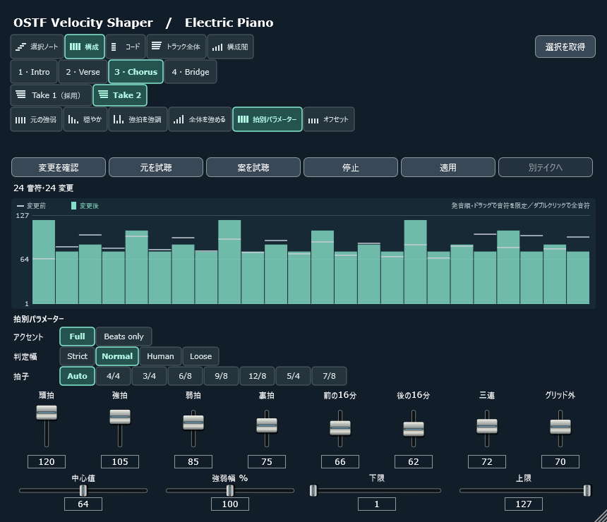
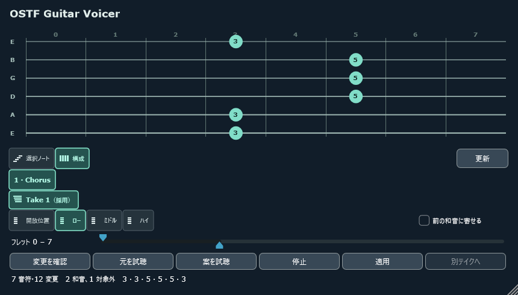
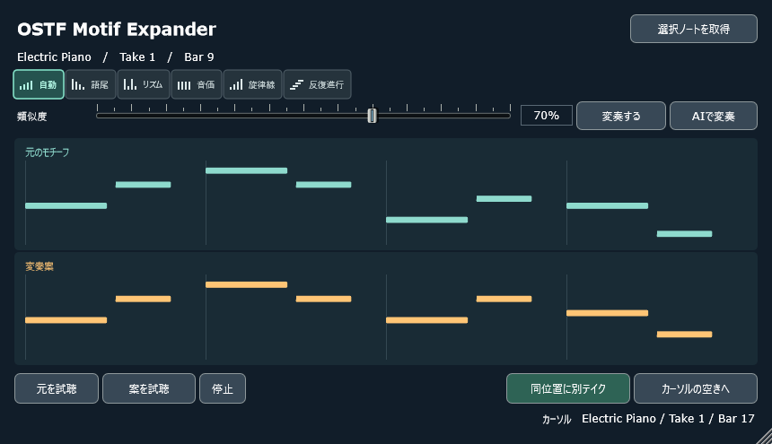
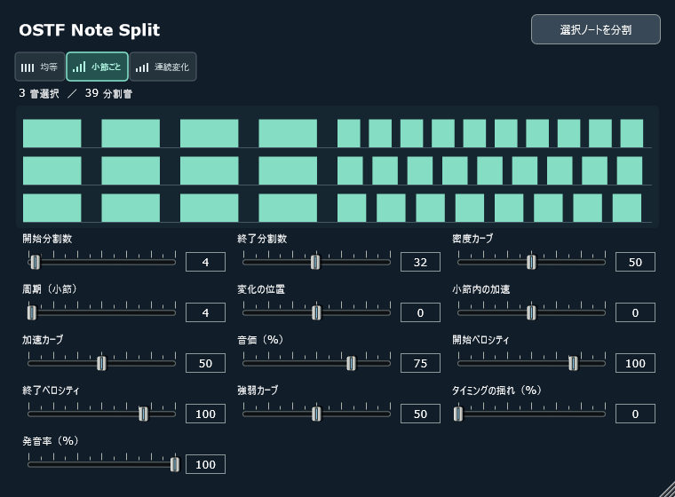
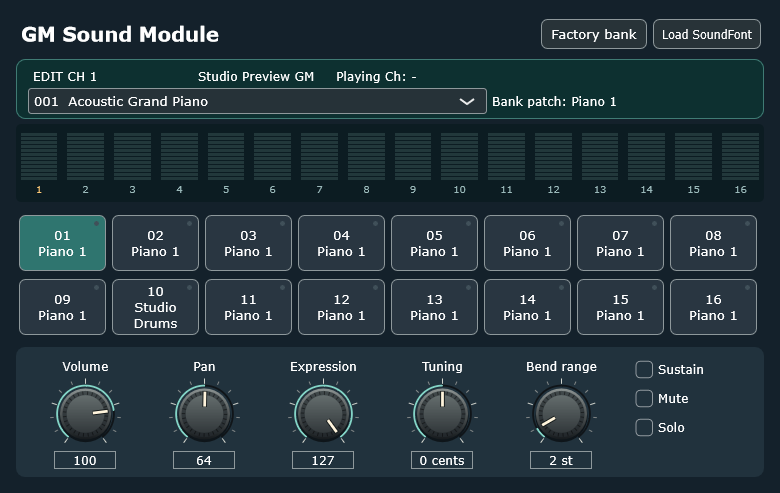
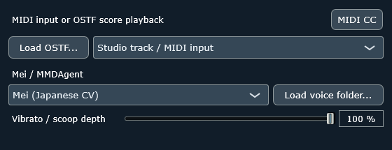
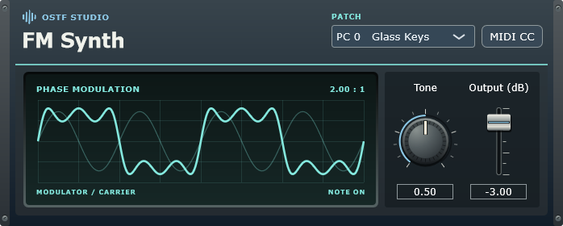
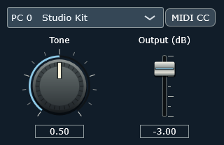
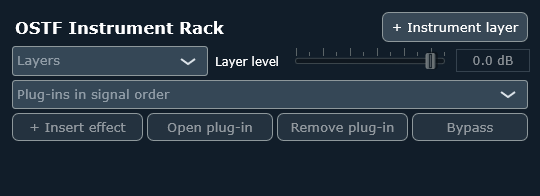
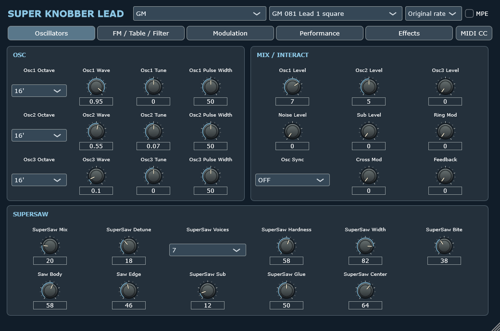

# 作曲ツールと音源

[English](workstations.en.md) · [図鑑の目次](README.md) · [Studio操作マニュアル](../manual/README.md)

ワークステーション・音源はDAWの音源枠に挿します。Studioのプロジェクトを編集する開発版のOSTFツールは、Studio内の対応トラックのスパナから開けます。

[OSTF Studio](#ostf-studio) · [OSTF Scale Editor](#ostf-scale-editor) · [OSTF Velocity Shaper](#ostf-velocity-shaper) · [OSTF Guitar Voicer](#ostf-guitar-voicer) · [OSTF Note Split](#ostf-note-split) · [OSTF Motif Expander](#ostf-motif-expander) · [GM Sound Module](#gm-sound-module) · [OSTF Formant Singer](#ostf-formant-singer) · [FM Synth](#fm-synth) · [Analog Synth](#analog-synth) · [Wavetable Synth](#wavetable-synth) · [Drum Machine](#drum-machine) · [Instrument Rack](#instrument-rack) · [SUPER KNOBBER LEAD](#super-knobber-lead)

## OSTF Studio

いつものDAWでOSTFの曲全体を演奏するワークステーションです。公開アルファ2のインストーラーで **OSTF Studio (VST3)** を選び、DAWの音源枠で開きます。まず「Paper Lantern Replies」を読み込み、ホストの再生ボタンで伴奏を鳴らしてください。

[詳しい操作と入出力](ostf-studio.md)

## OSTF Scale Editor

開発版ではプロンプトガイド右上のスパナと、ボイシングやオーディオトラックのスパナ からもScale Editorを追加できます。各枠に対応するツールが候補に表示されます。

開発版ではMIDIトラックの **Tools → OSTF Scale Editor** から追加し、そのトラックの音色で試聴できます。音源枠に挿した旧プロジェクトでは、保存した試聴音源を引き続き使用します。

公開アルファ2では、**OSTF Studio内の音源トラック**に **OSTF Scale Editor** をセットします。他のDAWでは、先に **OSTF Studio (VST3)** を立ち上げ、その中で曲を開きます。左ペインでコードを選び、候補を試聴して **スケールを設定** を押すと、左のコードに確定したスケール名とチェックが付きます。書き込み先が **和声** ならStudioのグローバルスケールレーンに、トラックならそのトラックのスケール指定に反映されます。曲はStudioまたは親DAWで保存します。

ヘッダーで試聴する構成を選んで **構成を試聴** を押します。**全曲を試聴** は曲頭から始まります。再生中のスケール名を見ながら、確定したスケールや未設定範囲の候補を聴けます。公開アルファ2ではヘッダーで試聴音源を選べます。 [スケールの設定と試聴](../manual/README.md#scale-assignment)

## OSTF Velocity Shaper

**Windows開発版**

開発版では **構成** を押すと構成名が横に並びます。構成、テイク、シェイプの順にタブを選ぶと、グラフで変更前後を確認できます。**拍別パラメーター** では縦フェーダーで各拍の強さを調節します。

MIDIトラックの **Tools → OSTF Velocity Shaper** で構成とテイクを選びます。「穏やか」「強拍を強調」「全体を強める」は、演奏時のベロシティーに差分を加えます。「自動移行・1拍」は構成の先頭で直前の構成のシェイプから切り替えます。前の構成に設定がなければ元の強弱から始まります。サビ頭を強調するときは「即時切替」を選びます。構成を曲順に適用すると、次の構成が直前の設定を参照できます。

順不同で構成を編集したときは、対象一覧の **設定済みの構成間をなじませる** を選ぶと、採用テイクの入口だけを一括で再計算できます。

**変更を確認 → 元を試聴／案を試聴 → 適用** の順に操作します。試聴にはトラックのローカル音源を使います。**別テイクへ** を選ぶと、対応するOSTF 5.1／5.2の構成で演奏を複製し、元テイクを採用したまま結果を保存できます。採用の切替はStudioのテイクメニューで行います。

対象欄では、ピアノロールの選択ノート、小節・拍で区別したコード1回分、構成、テイク区間、このMIDIトラック全体から選べます。右隣で、その範囲の採用テイクまたは別テイクを指定します。トラック全体に複数のコンプ区間がある場合は採用中の演奏が対象です。特定の別テイクを編集するときは、そのテイク区間を選びます。ピアノロールの選択ノートには、表示中のテイクが使われます。

**拍別パラメーター** で強拍・裏拍・コントラストなどを調整すると、発音順のグラフが更新されます。灰色の線が元のベロシティ、緑の棒が適用後の値です。ノートが密な列には最大値を表示します。ポインターを重ねると数値を確認できます。**オフセット** では現在値に一定量を加減します。グラフをクリックまたはドラッグすると対象をさらに絞れます。ダブルクリックで範囲内の全音符に戻ります。**適用** 後はStudioの「元に戻す」1回で取り消せます。

## OSTF Guitar Voicer

**Windows開発版**

音程のあるMIDIトラックで **Tools → OSTF Guitar Voicer** を開き、構成、テイク、最低・最高フレットを選びます。標準チューニングの6弦に各和音を振り分け、最初の和音の押弦位置を指板に表示します。「前の和音に寄せる」は直前の構成の最後の和音と、同じ構成内の直前の和音を参考にします。

同じクリップの同時発音が3〜6音、かつ3種類以上の音名を持つ和音が対象です。既存の音符の長さと強弱を保ち、不足する弦は高音側の元音符を複製して補います。単音、アルペジオ、指定範囲で組めない和音は対象外の件数に表示します。個別の和音には「ピアノロール・選択ノート」も使えます。

構成名のタブで対象を選ぶと、押弦位置が指板に表示されます。開放位置・ロー・ミドル・ハイを押して聴き比べ、必要ならスライダーの両端でフレット範囲を絞ります。

## OSTF Motif Expander

**Windows開発版**

音程のあるMIDIトラックでスパナを押し、**OSTF Motif Expander** を追加します。ピアノロールで同じテイクの音符を1～96音選び、**選択ノートを取得** を押します。上段に元のフレーズ、見出しにトラック名・テイク名・開始小節が表示されます。

**語尾** や **リズム** などの変奏方法と類似度を選び、**変奏する** を押します。下段の案と上段の原形は同じ時間軸・音域で表示されます。**元を試聴** と **案を試聴** で聴き比べてください。**AIで変奏** は取得した音符と変奏設定をStudioの接続先に送り、応答を同じ下段に表示します。接続は各ツールウィンドウ上部のボタンから設定できます。

- **同位置に別テイク** はOSTF 5.1／5.2の選択元を含むクリップまたは既存のテイク区間を複製し、選択音に変奏を反映します。採用テイクの指定は維持されます。歌詞とリンクした音や専用のコンプマップが必要なクリップでは、元データを保護するため対象外になる場合があります。
- **カーソルの空きへ** は選択中のMIDIトラックと編集テイクのカーソル位置に案を配置します。コンプがある位置では、選んだテイクの出力クリップ内にフレーズ全体が収まる空き区間を選びます。どちらの配置も一度の「取り消す」で戻せます。

## OSTF Note Split

**Windows開発版**

MIDIトラックの **Tools → OSTF Note Split** を開き、ピアノロールで分割したい音符を選びます。白い縁とチェックが選択の目印です。複数音を選ぶと、それぞれの元の音価の中で分割します。

**均等** は音符ごとに同じ回数で刻みます。**小節ごと** は開始密度から終了密度への変化を指定小節数で繰り返します。**連続変化** は音の途中で徐々に刻みを変え、拍や小節に合わせることもできます。プレビューは先頭6音を表示し、棒の幅で音価、高さで強弱を示します。**選択ノートを分割** で全選択音に適用します。発音率によって分割音がゼロになった元音は保持します。Studioの「元に戻す」1回で適用前に戻せます。

## GM Sound Module

1台で16のMIDIチャンネルを受けるGeneral MIDI音源です。ピアノとベースを別チャンネルに割り当て、各パートの音色を選ぶと、1つの音源でアンサンブルを鳴らせます。

## OSTF Formant Singer

OSTFの旋律と歌詞を歌わせる音源です。普段のDAWでは **Load OSTF** で歌詞と音符のある曲を開き、歌唱パートを選んで再生します。長く伸ばす音で **Vibrato / scoop depth** の効果を聴き比べられます。

短いフレーズでは、表示歌詞に英単語、対応する発音歌詞にカタカナを入れたボーカルパートを試せます。デモの **Paper Lantern Replies** のコーラスで、短い子音のつながりと伸ばした母音を聴き比べられます。

## FM Synth

プリセットで変調比を選び、**Tone** を動かしてみてください。画面には発音開始時の変調波と、その変調をかけた波形が重なります。

## Analog Synth

木製サイドパネルの内側に、発音開始時のローパス特性を表示します。**Tone** を上げてカーブの折れ曲がりが高域側へ移る様子を見ながら、同じベースラインを弾いてみてください。

## Wavetable Synth

**Tone** を動かすと、積層表示の中で基準位置の波形が明るく浮かびます。**Air Pad** と **Digital Stab** を切り替えて、音の動きも聴き比べてください。

## Drum Machine

MIDIノートをキック、スネア、ハイハットなどに割り当てるドラム音源です。同じパターンを **Studio Kit** と **Tight Machine** で再生し、キットによる減衰の違いを比べられます。

## Instrument Rack

1つのMIDI演奏で複数の音源を重ねます。**+ Instrument layer** で音源を2つ追加し、それぞれの **Layer level** で、たとえばピアノに薄くパッドを重ねられます。

## SUPER KNOBBER LEAD

M4L版LEAD v1.2の音色を、Studioや他のDAWのMIDIトラックで演奏できます。上部でジャンルとプリセットを選びます。たとえば **GM → GM 082 Lead 2 sawtooth** を選び、**FM / Table / Filter → Cutoff** を動かすと、原音の明るさを調整できます。ノブはDAWから直接オートメーションできます。

**Original rate** が初期設定です。高音で歪みを使うときは **2x oversampling** に切り替えて響きを比べられます。どちらもホストに報告するレイテンシーは16サンプルです。

[詳しい操作と入出力](super-knobber-lead.md)

[プラグイン図鑑の目次に戻る](README.md)
