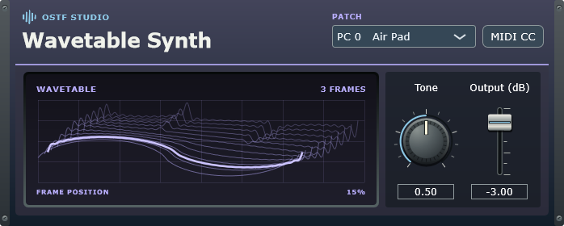

# 作曲ツールと音源

[English](workstations.en.md) · [図鑑の目次](README.md) · [Studio操作マニュアル](../manual/README.md)

MIDIトラックに挿し、曲全体を鳴らす、歌詞を歌わせる、または演奏に音色を付けるためのプラグインです。

[OSTF Studio](#ostf-studio) · [OSTF Scale Editor](#ostf-scale-editor) · [GM Sound Module](#gm-sound-module) · [OSTF Formant Singer](#ostf-formant-singer) · [FM Synth](#fm-synth) · [Analog Synth](#analog-synth) · [Wavetable Synth](#wavetable-synth) · [Drum Machine](#drum-machine) · [Instrument Rack](#instrument-rack)

## OSTF Studio

いつものDAWでOSTFの曲全体を演奏するワークステーションです。開発版のインストーラーで **OSTF Studio (VST3)** を選び、DAWの音源枠で開きます。まず「Paper Lantern Replies」を読み込み、ホストの再生ボタンで伴奏を鳴らしてください。

## OSTF Scale Editor

開発版では、**OSTF Studio内の音源トラック**に **OSTF Scale Editor** をセットします。他のDAWでは、先に **OSTF Studio (VST3)** を立ち上げ、その中で曲を開きます。左ペインでコードを選び、候補を試聴して **スケールを設定** を押すと、左のコードに確定したスケール名とチェックが付きます。書き込み先が **和声** ならStudioのグローバルスケールレーンに、トラックならそのトラックのスケール指定に反映されます。曲はStudioまたは親DAWで保存します。

## GM Sound Module

1台で16のMIDIチャンネルを受けるGeneral MIDI音源です。ピアノとベースを別チャンネルに割り当て、各パートの音色を選ぶと、1つの音源でアンサンブルを鳴らせます。

## OSTF Formant Singer

OSTFの旋律と歌詞を歌わせる音源です。普段のDAWでは **Load OSTF** で歌詞と音符のある曲を開き、歌唱パートを選んで再生します。長く伸ばす音で **Vibrato / scoop depth** の効果を聴き比べられます。

## FM Synth

ベルやエレピのように打鍵の輪郭が立つFM音源です。同じ和音で **Glass Keys** と **Bell Cascade** を切り替え、余韻の違いを聴いてみてください。

## Analog Synth

ベースからブラス系までをカバーするアナログ方式のシンセです。**Round Bass** を低い音域で弾き、**Twin Saw** に切り替えると倍音の違いが聴けます。

## Wavetable Synth

波形を移り変わらせるパッドや短いスタブ向けの音源です。**Air Pad** で和音を伸ばして **Tone** を動かし、同じ和音を **Digital Stab** で短く刻んでみてください。

## Drum Machine

MIDIノートをキック、スネア、ハイハットなどに割り当てるドラム音源です。同じパターンを **Studio Kit** と **Tight Machine** で再生し、キットによる減衰の違いを比べられます。

## Instrument Rack

1つのMIDI演奏で複数の音源を重ねます。**+ Instrument layer** で音源を2つ追加し、それぞれの **Layer level** で、たとえばピアノに薄くパッドを重ねられます。

[プラグイン図鑑の目次に戻る](README.md)
